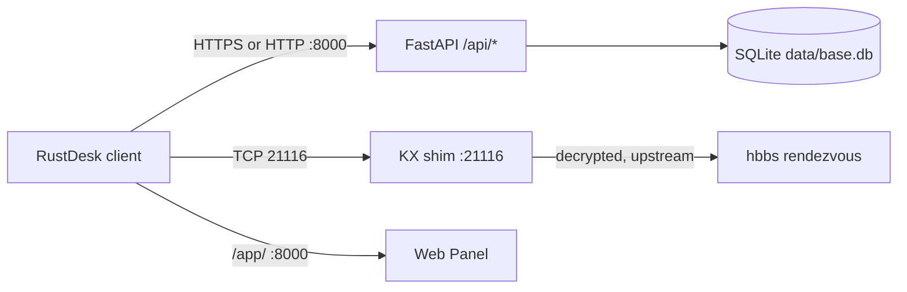

# RustDesk API

Self-hosted **Address Book API** for the stock RustDesk client, plus a **Web Panel**
and a **KX shim** that lets logged-in clients complete the secure rendezvous
handshake against an OSS `hbbs`.

- **No RustDesk client modifications.** The client talks to this project exactly
  like it talks to the official server API.
- **One database.** Everything (users, books, devices, tags, sessions) lives in
  SQLite at `data/base.db` by default, migrated with Alembic. Existing installs
  may set `DATABASE_URL` to another SQLite file (for example
  `data/pc-service.db`); keep that setting so existing data stays visible.
- **Discovery without client changes.** The KX shim records RustDesk IDs seen
  in rendezvous `register_peer` / `register_pk` messages. No client API address
  is needed for this part, and records persist after disconnect.
- **Optional client inventory.** Stock clients that use this server as their
  `api-server` upload hostname, username, OS, CPU, total RAM and client version
  via `/api/sysinfo`. Missing facts are shown as `Not reported`, never invented.
- **One command to run.** `python -m app` (or `./scripts/start.sh`) starts the
  API, serves the Web Panel, and supervises the shim.

## Project overview

RustDesk clients can keep an address book (devices, aliases, tags, notes,
per-device passwords) on a server via `/api/ab/*`. This project is a compatible
implementation of that server API, extended with:

- `API` (FastAPI) — login, personal/shared address books, peers, tags,
  device heartbeats (`/api/heartbeat` → `last_seen` presence).
- `Web Panel` — React SPA at `/app/` for managing books, devices, tags,
  users and the admin event log (a legacy server-rendered UI remains at
  `/panel/`).
- `KX shim` — a rendezvous proxy on TCP `21116`. Logged-in RustDesk clients
  require a server-first `KeyExchange` handshake that OSS `hbbs` never sends,
  which otherwise ends in `Failed to secure tcp: deadline has elapsed`.
  The shim performs the server side of that handshake (using your hbbs
  signing key) and proxies the decrypted traffic to the real `hbbs`.
  Plain (logged-out) clients pass through untouched.

Request path:



Already implemented: login/token sessions, personal + shared books with
read/write/full-control rules, peers CRUD, tag CRUD incl. colors and rename,
user admin (incl. rename), book rename/delete, AND/OR tag filters, search, pagination, presence
(`online`/`offline`/`unknown` + `last_seen`), rate limits, request size cap,
per-connection caps on the shim, file permissions hardening, backup/restore CLI,
and an admin-only append-only audit log (`/audit`, `/api/v1/audit*`).

## Quick start

Debian/Ubuntu, Python 3.13 (no `sudo` needed — all ports are > 1024).

### Fastest path

Run from the repository root. Each command is separate so a failure is easy
to locate.

```bash
git clone <your-repo-url> rustdesk-manager
cd rustdesk-manager
```

```bash
python3 -m venv --without-pip .venv
```

(Debian Python ships without `ensurepip`; the flag avoids a broken pip install.)

```bash
.venv/bin/python /tmp/get-pip.py
```

(`get-pip.py` from https://bootstrap.pypa.io/get-pip.py — download it first
if it is not at `/tmp/get-pip.py`.)

```bash
.venv/bin/pip install -r requirements.txt
```

```bash
cp .env.example .env
```

Edit `.env` and set the two required secrets (see [Configuration](#configuration)):

```bash
.venv/bin/python -m app.cli gen-key
```

```bash
./scripts/start.sh
```

Expected result: log line `migrations ok`, then Uvicorn serving on
`http://127.0.0.1:8000`. Health check:

```bash
curl http://127.0.0.1:8000/health/ready
```

Expected: `{"status":"ready","db":"up","shim":{"state":"disabled"}}`.
(`disabled` is correct until you enable the shim.)

Create the first admin (leave the server running, use a second terminal):

```bash
.venv/bin/python -m app.cli create-admin
```

First test request (replace `USER`/`PASS`):

```bash
curl -X POST http://127.0.0.1:8000/api/login \
  -H 'Content-Type: application/json' \
  -d '{"username":"USER","password":"PASS","type":"account"}'
```

Expected: `200` with `{"access_token":"...","type":"access_token","user":{...}}`.
Save the token and list books:

```bash
curl -X POST http://127.0.0.1:8000/api/ab/personal \
  -H 'Authorization: Bearer TOKEN' -H 'Content-Length: 0'
```

Expected: `200` with `{"guid":"..."}`.

Stop everything: `Ctrl+C` in the server terminal, or:

```bash
./scripts/stop.sh
```

### Manual setup

Same steps as above, but start the API directly to see each stage:

```bash
.venv/bin/python -m app
```

It validates configuration (fails fast on missing secrets), ensures
`data/`/`logs/` with safe permissions, runs `alembic upgrade head`, then serves.
Works from any directory — paths are anchored at the project root, never at CWD.

To enable the shim, set in `.env` (see [Configuration](#configuration)):

```bash
SHIM_ENABLED=1
SHIM_LISTEN=127.0.0.1:21116
SHIM_UPSTREAM=127.0.0.1:21166
SHIM_ID_KEY=/abs/path/to/hbbs-id_ed25519
```

and move your `hbbs` rendezvous to the upstream port (`hbbs -p 21166 …`),
so the shim owns `21116`. Restart the app. `/health/ready` should report
`"shim":{"state":"running",...}`. Point the RustDesk client ID server at the
shim host, keep the same Key as for `hbbs`.

### Docker setup

Needs Docker Engine with the Compose plugin. The image builds the React panel
itself, runs as non-root UID 1000 with read-only code, and keeps the database
and generated secrets in the `/app/data` volume.

The settings that depend on your installation (secrets, database, sessions,
proxy, shim, audit) are listed with defaults and comments in
`docker-compose.yml` (`environment:`). Edit them there, then run
`docker compose up -d`. Tuning knobs keep their defaults; the full list is
in [Configuration](#configuration).

```bash
mkdir -p data keys
cp /path/to/hbbs-id_ed25519 keys/id_ed25519 && chmod 600 keys/id_ed25519  # only if SHIM_ENABLED=1
docker compose up -d --build
docker compose logs -f app           # expect "migrations ok"
curl http://127.0.0.1:21114/health/ready
docker compose exec app docker-entrypoint.sh python -m app.cli create-admin
```

- `DEVICE_SECRET`/`WEB_SECRET` come from a `.env` next to the compose file,
  or are generated on first start and saved in `data/.secrets.env`
  (mode 600). Keep that file: a new `DEVICE_SECRET` makes stored device
  passwords unreadable.
- Ports `21114` (API + panel) and `21116` TCP **and** UDP (shim). Behind a
  reverse proxy on the same host publish `"127.0.0.1:21114:21114"`.
- One-off CLI commands go through the entrypoint so that generated secrets
  are loaded: `docker compose exec app docker-entrypoint.sh python -m app.cli …`.
- hbbs on the Docker host: `SHIM_UPSTREAM: "host.docker.internal:21166"`.
- `./data` must be writable by UID 1000, otherwise set `user: "UID:GID"`.
- Prebuilt image: set `image: <user>/rustdesk-manager:<tag>`, then
  `docker compose pull && docker compose up -d`.

Stop keeps data: `docker compose down`. Startup sequence, upgrades, moving a
native install into Docker, publishing to Docker Hub:
`docs/development/WORKFLOW.md` §4.

## Configuration

All settings are environment variables (or `.env` file), all optional except
the two secrets. Defaults in code (`app/core/config.py`). `.env.example` and
`docker-compose.yml` list only the installation-specific ones; this table is
the full list.

| Variable                                     | Required                      | Format                                                             | Used by                                                                       | Example                       |
| -------------------------------------------- | ----------------------------- | ------------------------------------------------------------------ | ----------------------------------------------------------------------------- | ----------------------------- |
| `DEVICE_SECRET`                            | yes (or `DEV_MODE=1`)       | Fernet key from `app.cli gen-key`                                | Encrypts stored device passwords                                              | `LGop…oe4=` (44 chars)     |
| `WEB_SECRET`                               | yes (or `DEV_MODE=1`)       | random 32+ chars, e.g. `openssl rand -hex 32`                    | Signs legacy panel cookie sessions                                            | `9f2c…`                    |
| `DEV_MODE`                                 | no (`0`)                    | `0`/`1`                                                        | Tolerates missing secrets (dev only)                                          | `0`                         |
| `HOST` / `PORT`                          | no (`127.0.0.1`/`8000`)   | IP / port                                                          | FastAPI listen address                                                        | `0.0.0.0` / `8000`        |
| `DATABASE_URL`                             | no (default `data/base.db`) | SQLAlchemy URL                                                     | DB location (absolute; relative sqlite paths are re-anchored under `data/`) | `postgresql+psycopg://…`   |
| `SESSION_DAYS`                             | no (`30`)                   | int, `0` = never expires                                         | API token lifetime                                                            | `7`                         |
| `MAX_PEER_ONE_AB`                          | no (`0` = unlimited)        | int                                                                | Per-book device limit (`403 exceed_max_devices`)                            | `500`                       |
| `SHIM_ENABLED`                             | no (`0`)                    | `0`/`1`                                                        | Starts the KX shim supervisor                                                 | `1`                         |
| `SHIM_LISTEN`                              | no (`127.0.0.1:21116`)      | `host:port`                                                      | **Bind** address of the shim — must be local to this machine           | `0.0.0.0:21116` for LAN     |
| `SHIM_UPSTREAM`                            | no (`127.0.0.1:21166`)      | `host:port`                                                      | Real `hbbs` rendezvous — never the relay port `21117`                    | `<hbbs-host>:21116`         |
| `SHIM_ID_KEY`                              | yes if shim on                | abs path to hbbs **private** `id_ed25519` (64-byte secret) | Signs the server KeyExchange                                                  | `/opt/keys/hbbs-id_ed25519` |
| `SHIM_MAX_CONNS` / `SHIM_PER_IP_PER_MIN` | no (`200`/`30`)           | int                                                                | Shim DoS caps                                                                 | —                            |
| `MAX_BODY_BYTES`                           | no (`5242880`)              | int                                                                | HTTP body cap → `413`                                                      | —                            |
| `LOGIN_PER_MINUTE_PER_IP`                  | no (`20`)                   | int                                                                | Login throttle → `429`                                                     | —                            |
| `HEARTBEAT_PER_MINUTE_PER_DEVICE`          | no (`20`)                   | int                                                                | Per-device heartbeat throttle (key: `id` + client IP) → `429`              | —                            |
| `HEARTBEAT_PER_MINUTE_PER_IP`              | no (`6000`)                 | int                                                                | Aggregate per-IP heartbeat flood cap → `429`                               | —                            |
| `SYSINFO_PER_MINUTE_PER_IP`                | no (`6000`)                 | int                                                                | Aggregate per-IP sysinfo cap (covers a first-boot burst) → `429`            | —                            |
| `AUDIT_REPORT_PER_MINUTE_PER_IP` | no (`600`) | int | Per-IP cap for device connection reports `/api/audit/*` → `429` | — |
| `TRUSTED_PROXIES`                          | no (empty)                  | comma-separated IPs                                                | Trust `X-Forwarded-For` from these peers for rate limits; empty = ignore      | `127.0.0.1`                   |
| `EXPOSE_DOCS`                              | no (`0`)                    | `0`/`1`                                                          | Serve `/docs`, `/redoc`, `/openapi.json` (auto-on in `DEV_MODE`)              | `0`                           |
| `LOG_LEVEL`                                | no (`INFO`)                 | logging level                                                      | Uvicorn log level                                                             | `WARNING`                   |
| `SESSION_COOKIE_SECURE` | no (`auto`) | `auto`/`1`/`0` | Panel cookie `Secure` flag (`auto` = on HTTPS requests) | `1` |
| `PASSWORD_HASH_WORKERS` / `PASSWORD_HASH_QUEUE` | no (`2`/`8`) | int | bcrypt threads / logins in flight before `429` | — |
| `SHIM_UDP_MAX_SESSIONS` / `SHIM_UDP_PER_IP_PER_MIN` | no (`2048`/`600`) | int | Shim UDP session caps | — |
| `SHIM_DIAG_MSGTYPES` | no (`0`) | `0`/`1` | Log decrypted message types + target IDs (never keys/tokens) | `0` |
| `DISCOVERY_ENABLED` | no (`1`) | `0`/`1` | Devices seen by the shim appear as "discovered" | `1` |
| `DISCOVERY_ONLINE_SEC` | no (`180`) | int, s | Discovered device counts as offline after this silence | — |
| `DISCOVERY_NEW_IDS_PER_IP_PER_MIN` | no (`30`) | int | New device IDs accepted per IP per minute | — |
| `DISCOVERY_CONNECTION_DEDUPE_SEC` | no (`60`) | int, s | One connection-log entry per initiator/target within this window | — |
| `AUDIT_ENABLED` | no (`1`) | `0`/`1` | Event log (`/audit`) | `1` |
| `AUDIT_RETENTION_DAYS` | no (`90`) | int, clamped 30..90 | Event log retention | `30` |
| `AUDIT_CLEANUP_INTERVAL_SEC` / `AUDIT_CLEANUP_INITIAL_DELAY_SEC` | no (`86400`/`60`) | int, s | Retention job schedule | — |
| `AUDIT_SLOW_REQUEST_MS` | no (`2000`) | int, `0` = off | Slow request warning threshold | — |
| `AUDIT_READ_DEDUPE_SEC` | no (`300`) | int, s | Repeated reads collapse into one access entry | — |
| `APP_NAME` | no (`RustDesk API`) | string | FastAPI title | — |

In the Docker image `HOST=0.0.0.0`, `PORT=21114`, `SHIM_LISTEN=0.0.0.0:21116`
and `SHIM_ID_KEY=/app/keys/id_ed25519` are preset; `docker-compose.yml`
lists only the settings that depend on the installation. Any other variable
from this table can be added to its `environment:` block.

API↔shim wiring is exactly three values: `SHIM_LISTEN` (where clients
connect), `SHIM_UPSTREAM` (where the real hbbs listens), `SHIM_ID_KEY`
(the private key the shim signs with). Never publish secrets, keys, tokens
or passwords — use obvious placeholders.

## Verification

- API: `curl http://127.0.0.1:8000/health/ready` → `ready`, `db: up`.
- Shim: same endpoint → `shim.state: running, alive: true` (or `disabled`
  when off; `down` after repeated crashes — see Troubleshooting).
- Secure channel: point a logged-in client at the shim and connect from the
  address book; the shim log shows `secure established`, the client connects
  instead of `Failed to secure tcp`. Logged-out clients show
  `plain passthrough`.
- Minimal request: the `/api/login` + `/api/ab/personal` calls from Quick start.

## Troubleshooting

- **App exits with `FATAL: DEVICE_SECRET/WEB_SECRET is not set`** — set both
  in `.env`, or `DEV_MODE=1` for local experiments only.
- **`.venv/bin/python: No module named app`** — run from the repo root
  (or `PYTHONPATH=<root>`); `scripts/start.sh` handles this.
- **Port already in use (`:8000`/`:21116`)** — `ss -tlnp | grep -E '8000|21116'`,
  stop the stale process (`./scripts/stop.sh` validates the PID file and falls
  back to matching `python -m app` by cwd/cmdline).
- **`/health/ready` → shim `down`** — the shim crashed repeatedly (bad key,
  port busy, upstream unreachable). Read stdout/stderr (`journalctl` or
  `docker compose logs`); fix and restart.
- **Shim crash-loop `address already in use`** — another `hbbs`/process owns
  `SHIM_LISTEN`. Either free it or move `hbbs` (`hbbs -p <other>`) and point
  `SHIM_UPSTREAM` there.
- **`SHIM_LISTEN` on a foreign IP never binds** (`Cannot assign requested address`) — listen addresses must be local interfaces (`0.0.0.0` for LAN).
- **Shim signs nothing / `KX open failed`** — `SHIM_ID_KEY` must be the 64-byte
  **private** `id_ed25519`, not the 44-byte `.pub` file. Compare fingerprints
  with `scripts/check_keys.py` (prints hashes, never keys).
- **Client gets `LICENSE_MISMATCH`** — punch-stage key check in `hbbs`:
  the client Key field must equal the hbbs public key. Unrelated to the shim.
- **Login returns 429** — per-IP throttle tripped; wait a minute.
- **413 on large pushes** — body over 5 MB; raise `MAX_BODY_BYTES` if your
  legacy full-book push legitimately exceeds it.

## Further documentation

Two files, fully bilingual (English / Russian), same sections:

- `docs/en.md` — overview, quick start, architecture, configuration,
  API reference, shim, security, development, troubleshooting, background.
- `docs/ru.md` — то же самое на русском.
