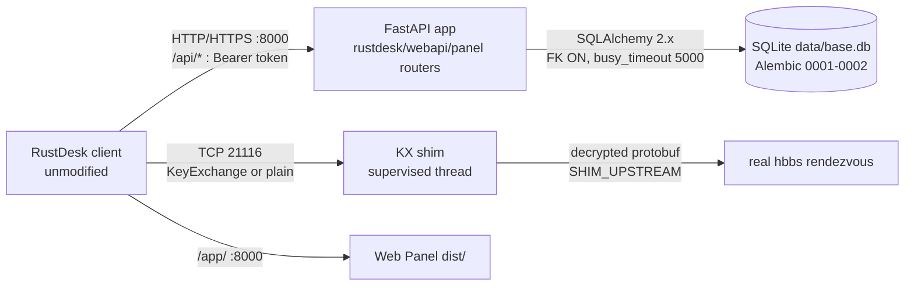

# RustDesk Manager — Documentation (English)

> [Русская версия](ru.md)

Self-hosted Address Book API for the stock RustDesk client, plus a Web Panel
and a KX shim that lets logged-in clients complete the secure rendezvous
handshake against an OSS `hbbs`. **No RustDesk client modifications.**

Contents: [1. Overview](#1-overview) · [2. Getting started](#2-getting-started) ·
[3. Architecture](#3-architecture) · [4. Configuration](#4-configuration) ·
[5. API reference](#5-api-reference) · [6. Shim](#6-shim) ·
[7. Security](#7-security) · [8. Development and testing](#8-development-and-testing) ·
[9. Troubleshooting](#9-troubleshooting) ·
[10. Background: the secure-tcp investigation](#10-background-the-secure-tcp-investigation)

---

## 1. Overview

RustDesk clients can keep an address book (devices, aliases, tags, notes,
per-device passwords) on a server via `/api/ab/*`. This project is a compatible
implementation of that server API, extended with a management panel and a
rendezvous shim.

Components and responsibilities:

- **API (FastAPI)** — login/token sessions, personal + shared address books
  (`read`/`readWrite`/`fullControl`), peers CRUD, tag CRUD incl. colors and
  rename, customers, user admin, search, AND/OR tag filters, pagination,
  presence (`online`/`offline`/`unknown` + `last_seen` from device heartbeats).
- **Web Panel** — React 19 + Vite + TS + Tailwind 4 SPA at `/app/` (a legacy
  server-rendered UI remains at `/panel/`).
- **KX shim** — rendezvous proxy on TCP `21116`. Logged-in RustDesk 1.4.x
  clients require a server-first `KeyExchange` handshake that OSS `hbbs`
  never sends (otherwise `Failed to secure tcp: deadline has elapsed`).
  The shim performs the server side of that handshake using your hbbs signing
  key and proxies decrypted traffic to the real `hbbs`. Plain (logged-out)
  clients pass through untouched.
- **Storage** — one SQLite database at `data/base.db`, Alembic migrations.

Capabilities and limits of this version: no Docker setup, no built-in TLS
termination (use Caddy/Nginx in front for anything beyond loopback), no
per-user customer isolation (customers are global), legacy panel has no
per-form CSRF tokens (SameSite=Lax only), heartbeat presence is spoofable
within rate limits (devices have no credentials by client design).

## 2. Getting started

Debian/Ubuntu, Python 3.13, no root needed (all default ports > 1024).
No Docker. For an optional React rebuild: Node.js 22 LTS.

From the repository root — separate commands so a failure is easy to locate:

```bash
git clone <your-repo-url> rustdesk-manager
cd rustdesk-manager
python3 -m venv --without-pip .venv
```

(Debian Python ships without `ensurepip`; the flag avoids a broken pip.)

```bash
.venv/bin/python /tmp/get-pip.py
```

(`get-pip.py` from https://bootstrap.pypa.io/get-pip.py.)

```bash
.venv/bin/pip install -r requirements.txt
cp .env.example .env
```

Set the two required secrets in `.env` (verified installed pins: FastAPI
0.143.0, Uvicorn 0.54.0, SQLAlchemy 2.1.4, Pydantic 2.14.1, bcrypt 5.0.0;
the rest are ranges in `requirements.txt`):

```bash
.venv/bin/python -m app.cli gen-key   # paste output as DEVICE_SECRET=
# paste `openssl rand -hex 32` output as WEB_SECRET=
```

Without the secrets startup refuses (`FATAL: … is not set`) unless `DEV_MODE=1`
(local experiments only). Then:

```bash
./scripts/start.sh
```

What happens, in order: config validation → `data/`+`logs/` created (`0700`,
existing `data/base.db` set to `0600`) → `alembic upgrade head` → Uvicorn on
`HOST:PORT` (default `127.0.0.1:8000`) → shim supervisor starts iff
`SHIM_ENABLED=1`. `python -m app` does the same and works from any directory
(paths are anchored at the project root, never at CWD).

Verify:

```bash
curl http://127.0.0.1:8000/health/ready
```

→ `{"status":"ready","db":"up","shim":{"state":"disabled"}}`
(`disabled` is normal without the shim; `running/alive:true` when enabled;
`down` after repeated crashes — see §9). Panel: `http://127.0.0.1:8000/app/`.
Interactive API docs: `http://127.0.0.1:8000/docs`.

First admin (second terminal, server keeps running) and first request:

```bash
.venv/bin/python -m app.cli create-admin     # asks username + password
curl -X POST http://127.0.0.1:8000/api/login \
  -H 'Content-Type: application/json' \
  -d '{"username":"USER","password":"PASS","type":"account"}'
```

→ `200 {"access_token":"…","type":"access_token","user":{…}}`.
In the RustDesk client set API Server to `http://<host>:8000` and log in:

```bash
curl -X POST http://127.0.0.1:8000/api/ab/personal \
  -H 'Authorization: Bearer TOKEN' -H 'Content-Length: 0'
```

→ `200 {"guid":"…"}`.

Stop: `Ctrl+C` (SIGTERM works the same — API drains, shim thread stops with a
10 s join, no orphans) or `./scripts/stop.sh` (PID file `data/app.pid`).
Restart is the same start command; migrations are idempotent.

## 3. Architecture

One process serves HTTP and supervises the shim in a background thread.
One database. No microservices.



Request flow: `POST /api/login` → opaque server-side token (`sessions`,
expiry `SESSION_DAYS`; logout deletes it) → `POST /api/ab/*` with
`Authorization: Bearer` (book access re-checked per request via
`get_book_for_user` + `rule_for`) → devices `POST /api/heartbeat {id,…}`
stamp `last_seen` (derived: `online` ≤ 45 s, else `offline`, never-seen
`unknown`) → panel SPA uses `/api/v1/*` with the same token from memory.

Trust boundaries: the network is untrusted (every `/api/*` except
login/login-options/heartbeat/health needs a valid token; the shim protocol
itself has no authentication — contained by caps). Bearer tokens live only in
client memory and the `sessions` table. `data/` is `0700`, DB/backups `0600`;
the hbbs private key is read-only input, never committed/logged/returned.
`X-Forwarded-*` headers are never read. hbbs is trusted for punch/relay
mediation; it never sees API credentials.

Repo layout: `app/` (FastAPI: `main.py`, `__main__.py`, `api/`, `core/`,
`models/`, `schemas/`, `services/`, `db/`, `cli.py`, `shim/`,
`shim_supervisor.py`, `web/templates/`), `frontend/` (`src/`, prebuilt
`dist/`), `alembic/`, `tests/`, `scripts/` (`start.sh`/`stop.sh` plus
`repro_handshake.py`, `check_keys.py`, `test_kx_shim.py`), `config/`
(Caddy/systemd examples), `data/` + `logs/` (runtime state).

## 4. Configuration

Source of truth: `app/core/config.py` + `.env.example`. All settings are
environment variables; project-root `.env` is loaded automatically. Never
commit real values.

| Variable | Required | Format / default | Used by |
|---|---|---|---|
| `DEVICE_SECRET` | yes (or `DEV_MODE=1`) | Fernet key from `app.cli gen-key` | Encrypts stored device passwords; rotation loses them |
| `WEB_SECRET` | yes (or `DEV_MODE=1`) | random 32+ chars (`openssl rand -hex 32`) | Signs legacy panel cookie sessions; rotation only logs panel users out |
| `DEV_MODE` | `0` | `0`/`1` | Tolerates missing secrets — dev only |
| `HOST` / `PORT` | `127.0.0.1` / `8000` | IP / port | FastAPI listen; `0.0.0.0` for LAN (behind TLS, see §7) |
| `DATABASE_URL` | `data/base.db` | SQLAlchemy URL | DB location (absolute; relative sqlite paths re-anchored under `data/`; Postgres URL accepted) |
| `SESSION_DAYS` | `30` | int, `0` = never | Token lifetime (lower it, e.g. `7`, on hostile networks) |
| `MAX_PEER_ONE_AB` | `0` = unlimited | int | Per-book device limit; over → `403 exceed_max_devices` |
| `LOG_LEVEL` | `INFO` | level | Uvicorn log level |
| `SHIM_ENABLED` | `0` | `0`/`1` | Starts the supervised shim |
| `SHIM_LISTEN` | `127.0.0.1:21116` | `host:port` | **Bind** address — must be local (`0.0.0.0` for LAN); a foreign IP can never bind |
| `SHIM_UPSTREAM` | `127.0.0.1:21166` | `host:port` | Real hbbs rendezvous. Same box: `hbbs -p 21166`. Other box: `HBBS_IP:21116`. **Never relay `21117`** |
| `SHIM_ID_KEY` | yes if shim on | abs path to hbbs **private** `id_ed25519` (64-byte secret) | Signs the server KeyExchange; the 44-byte `.pub` cannot sign and is rejected |
| `SHIM_MAX_CONNS` / `SHIM_PER_IP_PER_MIN` | `200` / `30` | int | DoS caps on the rendezvous port |
| `MAX_BODY_BYTES` | `5242880` | int | Larger bodies → `413` |
| `LOGIN_PER_MINUTE_PER_IP` | `20` | int | More logins → `429` |
| `HEARTBEAT_PER_MINUTE_PER_IP` | `300` | int | More heartbeats → `429` |

API↔shim wiring is exactly: `SHIM_LISTEN` (where clients connect),
`SHIM_UPSTREAM` (where the real hbbs listens), `SHIM_ID_KEY` (what the shim
signs with). Example (LAN stand, placeholders):

```bash
DEVICE_SECRET='<gen-key output>'
WEB_SECRET='<openssl rand -hex 32>'
HOST=0.0.0.0
SHIM_ENABLED=1
SHIM_LISTEN=0.0.0.0:21116
SHIM_UPSTREAM=192.0.2.10:21116
SHIM_ID_KEY=/opt/keys/hbbs-id_ed25519
```

## 5. API reference

Verified against `app/api/*.py`; live schema at `/docs`. Auth: opaque Bearer
(except login, login-options, heartbeat, health). Errors: `401 {"error"}` and
RustDesk `{"error"}` with 400/403/404/409.

**RustDesk contract** (used by the unmodified client — shapes are frozen):

| Method | Path | Body → Response |
|---|---|---|
| POST | `/api/login` | `{username,password,type:"account",…}` → `200 {access_token,type:"access_token",user:{name,display_name,avatar,email,note,status,is_admin}}` |
| POST | `/api/currentUser` | `{id,uuid}` → user object |
| POST | `/api/logout` | `{id,uuid}` → `200` empty (token revoked) |
| GET | `/api/login-options` | → `[]` |
| POST | `/api/ab/settings` | empty → `{max_peer_one_ab}` |
| POST | `/api/ab/personal` | empty → `{guid}` (book auto-created) |
| POST | `/api/ab/shared/profiles?current=&pageSize=` | empty → `{total,data:[{guid,name,owner,note,info,rule}]}` (`1`=read `2`=readWrite `3`=fullControl) |
| POST | `/api/ab/peers?current=&pageSize=&ab={guid}` | empty → `{total,data:[Peer]}` (`id,username,hostname,platform,alias,tags[],note` + `hash` personal / `password` shared) |
| POST | `/api/ab/peer/add/{guid}` | one peer JSON → `200` empty; `409` exists, `422` bad ID, `403` read-only/limit |
| PUT | `/api/ab/peer/update/{guid}` | `{id,…fields}` (tags = full replacement set) → `200` empty |
| DELETE | `/api/ab/peer/{guid}` | `["id",…]` → `200` empty |
| POST | `/api/ab/tags/{guid}` | empty → `[{name,color}]` (bare array) |
| POST | `/api/ab/tag/add/{guid}` | `{name,color}` → `200` empty |
| PUT | `/api/ab/tag/rename/{guid}` | `{old,new}` → `200` empty |
| PUT | `/api/ab/tag/update/{guid}` | `{name,color}` (Flutter ARGB uint) → `200` empty |
| DELETE | `/api/ab/tag/{guid}` | `["name",…]` → `200` empty (devices kept) |
| POST | `/api/heartbeat` | `{id,uuid,ver,…}`, **no auth** → `{}`; stamps `last_seen` |
| GET/POST | `/api/ab` | legacy full-book stubs (`"null"` / empty 200) |
| GET | `/api/device-group/accessible`, `/api/users`, `/api/peers` | group-panel stubs → `{total:0,data:[]}` |

`rustdesk_id` outside `[A-Za-z0-9._-]` (notably `@ / \ ? & =`, whitespace)
is rejected with `422` — such IDs would redirect client transport.

**Panel JSON** (prefix `/api/v1`, same Bearer):

| Method | Path | Notes |
|---|---|---|
| GET | `/stats` | `{devices,online,offline,unknown}` over visible books |
| GET/POST | `/address-books` | list with counts; create `{name}` (admin, shared) |
| GET | `/address-books/{bid}/entries` | `search,tag[] (repeat),mode=and\|or,untagged,customer_id,presence=all\|online\|offline\|unknown,sort=alias\|rustdesk_id\|last_seen\|status,order,page,page_size(≤200)` → `{total,data}` with `customer{name}`, `tag_objs[{name,color}]`, `presence`, `last_seen`, `password_configured`, timestamps |
| POST | `/address-books/{bid}/entries` | `{rustdesk_id,alias,note,customer_id,tags[],password}`; `409` duplicate |
| GET/PUT/DELETE | `/entries/{eid}` | full object; empty `password` on PUT keeps the old one |
| GET/POST | `/address-books/{bid}/tags` | `[{id,name,color,devices}]`; `409` on duplicate |
| PUT/DELETE | `/tags/{tid}` | rename+color; delete removes links only |
| PUT/DELETE | `/entries/{eid}/tags/{tid}` | attach/detach |
| GET/POST | `/customers` (+PUT/DELETE `/{cid}`) | list includes `devices` count |
| GET/POST | `/users` (+PUT/DELETE `/{uid}`) | admin only; PUT `{is_admin?,is_disabled?,password?}`; self-delete/disable/demote refused |

**Legacy pages** (`/panel/*`, cookie session, HTML): `GET/POST /login`,
`GET /logout`, `/devices`, `/tags`, `/customers`, `/users` with matching
create/update/delete form posts; unauthenticated → `303 /panel/login`.

**Health:** `GET /health` → `{"ok":true}`; `/health/live` → live;
`/health/ready` → `200 ready/db/shim…` or `503` with the failing component
(all excluded from OpenAPI).

## 6. Shim

Setup: move your `hbbs` rendezvous off the client-facing port (`hbbs -p 21166`;
`21117` is the relay — never upstream), set the three `SHIM_*` values (§4),
restart, `GET /health/ready` → `"shim":{"state":"running","alive":true}`,
point the client ID server at the shim host with the same Key as for hbbs.
Log in and connect from the book: shim log shows `secure established`;
logged-out connects show `plain passthrough`.

Internals: on accept the shim immediately sends `KeyExchange{sign(box_pk)}`;
a 2-key `KeyExchange` reply switches the connection to secretbox (v0
`set_key` semantics: per-direction counters incremented before use, first
encrypted frame uses nonce 1, empty frames pass through untouched); any other
first frame means plain passthrough (plain clients ignore our KX via their
`get_next_nonkeyexchange_msg`). Failures: upstream unreachable → close after
10 s with a warning; crash loop → `down` + `503` on ready after 5 crashes in
10 min (backoff 1,2,4,8,16,30,60 s), API keeps serving; `/health/ready` is the
single status source. Standalone diagnostics mode exists in `scripts/`
(`repro_handshake.py`, `check_keys.py` — hashes only, `test_kx_shim.py`).

What the channel does and does not do (proven, not assumed): the client↔shim
leg is secretbox-encrypted with a per-connection sealed key; plaintext exists
only on the shim↔hbbs leg, which must stay on trusted loopback/LAN. Not
provided: client authentication at the rendezvous port (absent from the
protocol itself) — contained by the caps above. End-to-end session crypto
stays between the two RustDesk endpoints; the shim never sees it.

## 7. Security

Enforced in code and covered by tests (`test_security.py`,
`test_ratelimit.py`, `test_shim.py`, `test_connection_safety.py`):
bcrypt-only passwords; server-side sessions with logout revocation; per-request
book ownership/rule checks (second-user IDOR tests); no trust in client-sent
roles/owners (mass-assignment test); ORM + bound params + whitelisted sort
(SQLi-tested); `data/` `0700`, DB/backups `0600` enforced at startup;
Fernet device passwords, no secrets in logs (shim: fingerprints only);
no CORS middleware (same-origin SPA); no `X-Forwarded-*` reads; React without
`dangerouslySetInnerHTML`, Jinja autoescape on; error responses carry no
traces/paths/SQL. Dependency labels at last check: `pip-audit` clean,
`bandit` 0 High, `npm audit` 0 vulnerabilities.

Known accepted limits: unauthenticated heartbeat can skew presence within its
rate limit; customers are global; legacy panel has SameSite=Lax but no
per-form CSRF tokens; default `SESSION_DAYS=30` is long for hostile networks;
the app serves plain HTTP — terminate TLS in front (Caddy/Nginx) for anything
beyond loopback.

## 8. Development and testing

Dev env = install in §2 + `cd frontend && npm install` (Node.js 22) for UI work;
frontend dev server proxies `/api` to `127.0.0.1:8000`, `npm run build` writes
`frontend/dist/` served at `/app/`. Tests: `.venv/bin/pytest -q` — isolated
into `test.db` via `tests/conftest.py`+`tests/db.py`, never touches
`data/base.db`; coverage: auth, RustDesk contract, presence, ID validation,
connection-safety, rate limits, body cap, FK/pragma, path stability, panel
auth, IDOR, shim units/gates. Live-server scripts in `scripts/` are manual
tools (need a running `hbbs`), not CI. Change rule: test first, keep green,
no remote commits.

## 9. Troubleshooting

Order: `logs/app.log` → `/health/ready` → ports → config.
`FATAL: …SECRET… is not set` → fill `.env` (or `DEV_MODE=1` for experiments).
`No module named app` → run from repo root / use `start.sh`. Port busy →
`ss -tlnp`, stop the stale holder (`stop.sh` only kills PID-file processes).
Shim bind crash-loop → free `SHIM_LISTEN` or move `hbbs`. **`SHIM_LISTEN` on
a foreign IP can never bind** (`Cannot assign requested address` — observed
live); **`SHIM_ID_KEY` must be the 64-byte private `id_ed25519`, not the
44-byte `.pub`** (also observed live — signing with a public key is
impossible). `LICENSE_MISMATCH` = client Key ≠ hbbs pub (hbbs-side check,
unrelated to shim). Login `429` = throttle, wait a minute. `413` = raise
`MAX_BODY_BYTES` only for legitimately large pushes. `401 {"error"}` =
re-login. `403 exceed_max_devices` = quota. `422` on peer add = illegal ID
characters. Empty `200` on `/api/ab/*` actions = success. TLS problems are
fixed at the proxy/CA trust, never by disabling verification.

## 10. Background: the secure-tcp investigation

Logged-in 1.4.x clients mandate a server-first `KeyExchange` rendezvous
handshake (`client.rs:418-421`); OSS `hbbs` never speaks first (proven live:
TCP connects in ~2 ms, then 12–35 s of silence, and its source has no
`KeyExchange` handler) → `Failed to secure tcp: deadline has elapsed` before
any peer contact, whatever the keys. Logout drops the token → plain punch
(~1 ms, reproduced byte-for-byte) → works. Peer data cannot influence that
stage (same `connect()` path; passwords are post-handshake); the one
AB-specific transport vector (`@`/`/r` IDs) is rejected server-side with 422.
The shim above is the fix that keeps stock clients and OSS hbbs working
together. API scheme (HTTP vs HTTPS) changes nothing about this stage —
HTTPS protects client↔API credentials, which were previously plaintext.
