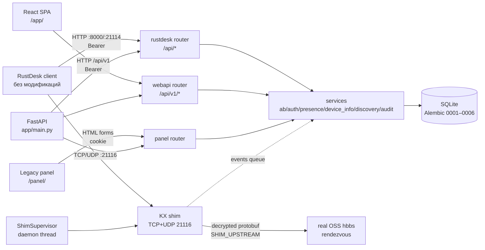
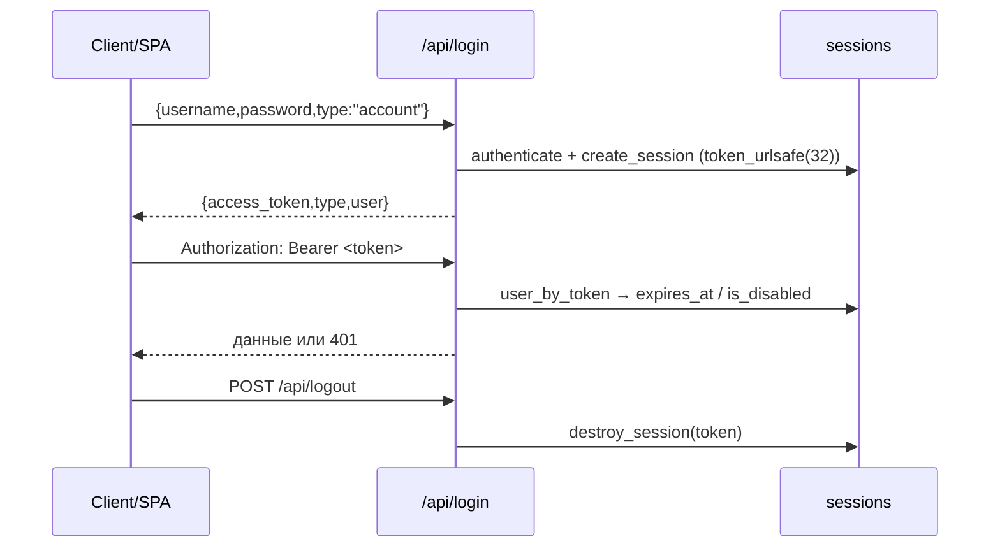
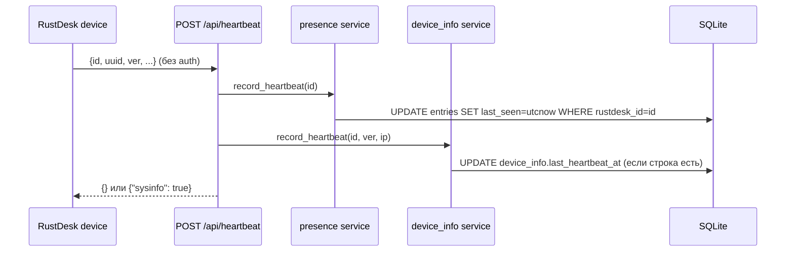
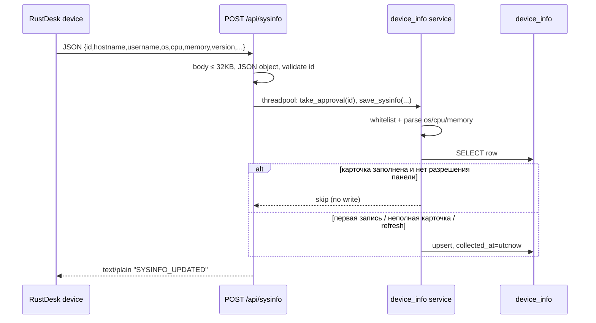
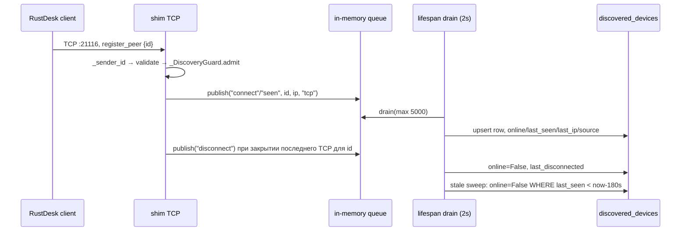
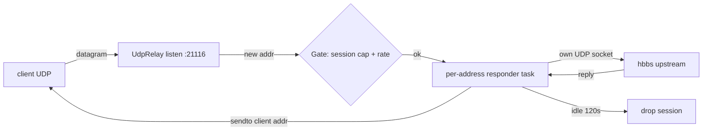

# ARCHITECTURE — устройство и потоки данных

Документ описывает **фактическую** реализацию. Публичный обзор с примерами
находится в `docs/ru.md` / `docs/en.md`; здесь — внутренние связи, границы
доверия и отказоустойчивость.

## 1. Модель процесса

Один процесс `python -m app`:

```text
┌──────────────────────────── main process ────────────────────────────┐
│ app/__main__.py                                                       │
│   settings (fail-fast) → ensure_dirs() → alembic upgrade head         │
│   → uvicorn.run("app.main:app")                                       │
│                                                                       │
│ FastAPI (asyncio event loop)                                          │
│   ├─ HTTP API /api/*, /api/v1/*, /panel/*, /app/*, /health*           │
│   ├─ discovery drain task (каждые 2 с, в thread)                      │
│   └─ ShimSupervisor (отдельный daemon-thread)                         │
│         └─ свой asyncio loop: TCP 21116 + UDP 21116                   │
│                                                                       │
│ SQLite (SQLAlchemy, один файл)                                        │
└───────────────────────────────────────────────────────────────────────┘
```

Ключевые следствия:

- HTTP и shim не изолированы процессами: падение shim не обязано ронять API,
  но общий процесс/ресурсы (GIL, память, SQLite) общие.
- Shim **не обращается к ORM** из своего потока. Он кладёт события в
  потокобезопасную очередь `app/services/discovery_events.py`, а основной
  процесс пишет их в БД.
- SQLite — один writer. Долгие запросы/массовые операции влияют на весь
  процесс.

## 2. Компоненты и связи



## 3. Запуск и lifespan

`app/__main__.py`:

1. Импортирует `app.core.config.settings` — при `DEV_MODE=0` отсутствие
   `DEVICE_SECRET` или `WEB_SECRET` завершает процесс с `SystemExit`.
   При `SHIM_ENABLED=1` проверяется существование `SHIM_ID_KEY`.
2. `ensure_dirs()` создаёт `data/` и `logs/`, ставит `data/` `0700`, а
   существующий файл БД по `resolved_database_url` — `0600`.
3. `run_migrations()` вызывает Alembic `upgrade head` (не отдельный процесс).
4. Запускает Uvicorn без reload.

`app/main.py` lifespan:

1. Если `DISCOVERY_ENABLED=1`, сбрасывает `discovered_devices.online=False`
   (после рестарта старых живых TCP-соединений быть не может).
2. Если `SHIM_ENABLED=1`, создаёт `ShimSupervisor` и запускает поток; каждые
   5 секунд вызывает `supervisor.watch()` для рестартов.
3. Если `DISCOVERY_ENABLED=1`, запускает задачу: каждые 2 секунды
   `drain_once()` выполняется через `asyncio.to_thread` (своя DB-сессия).
4. Если `AUDIT_ENABLED=1`, пишет `system.startup` и запускает фоновую
   retention-задачу: первая очистка через
   `AUDIT_CLEANUP_INITIAL_DELAY_SEC`, далее раз в
   `AUDIT_CLEANUP_INTERVAL_SEC` (по умолчанию сутки).
5. На shutdown отменяет задачи, пишет `system.shutdown` (если аудит включён)
   и останавливает shim (`join` до 10 с).

`/health/ready`:

- `check_ready()` → `SELECT 1`; ошибка → `503 {"status":"not-ready","db":"down"}`.
- Если шим включён и `supervisor.status()["state"] == "down"` → `503`.
- Иначе `200` с `db: up` и состоянием шима (`disabled`/`running`/...).

## 4. HTTP-конвейер

```text
Uvicorn
  → AuditMiddleware (X-Request-ID, context, значимые access/security-события)
  → SessionMiddleware (cookie, WEB_SECRET, SameSite=Lax, https_only=False)
  → RateLimitMiddleware (per-IP для login/sysinfo; per-device + aggregate per-IP для heartbeat)
  → BodyCapMiddleware (Content-Length > MAX_BODY_BYTES → 413)
  → router (rustdesk → webapi → panel)
  → dependency get_db() (SQLAlchemy Session на запрос; heartbeat и sysinfo — своя сессия в threadpool)
```

Особенности:

- `RateLimitMiddleware` хранит `deque` в модульном `HITS`; окно 60 секунд.
  `login`/`sysinfo` ключуются по IP; heartbeat — сначала по `(id, client IP)`,
  затем по агрегатному IP-потолку. Устаревшие ключи вычищаются не чаще раза
  в 60 с, чтобы per-device bucket'ы не росли безгранично.
- Heartbeat читает маленькое тело (≤8 KiB и только при наличии
  `Content-Length`), чтобы получить `id` для ключа; иначе остаётся только
  IP-потолок. Прочитанное тело кешируется Starlette и не читается повторно.
- `/api/heartbeat` выполняет SQLite-запись в threadpool (`run_in_threadpool`)
  со своей сессией: синхронный драйвер не должен блокировать event loop при
  всплеске подключений.
- `BodyCapMiddleware` проверяет только `Content-Length`; chunked-запрос без
  длины не ограничивается этим middleware (см. SEC-013), но heartbeat всё
  равно упирается в агрегатный IP-лимит.
- `client_ip()` использует прямой peer; `X-Forwarded-For` читается только
  если прямой peer входит в `TRUSTED_PROXIES`, и только для ключа лимита.
- `HITS` — in-memory и per-process. `python -m app` запускает один uvicorn
  worker; при нескольких процессах лимиты умножатся. Внешний store для
  счётчиков пока не реализован.
- `SessionMiddleware` нужен только legacy-панели; Bearer-токены SPA/клиента
  к cookie не привязаны.
- `AuditMiddleware` — внешний слой: назначает `X-Request-ID`, кладёт
  `request_id`/`source_ip`/маршрут в `contextvar` и после ответа пишет
  access/security-строку только для значимых запросов (мутации, 4xx/5xx,
  чтение конкретного ресурса). Повторные чтения и 429 схлопываются, а
  `/api/heartbeat`, `/api/sysinfo*` и сам `/api/v1/audit` не журналируются
  построчно. Технические логи остаются в stdout/stderr и не дублируются в
  SQLite.

### 4.1. Аудит и технические логи

Два потока намеренно разделены:

- **Техническая диагностика** — `logging` в stdout/stderr: ошибки,
  медленные запросы (`AUDIT_SLOW_REQUEST_MS`), троттлинг 429. Ротацию
  выполняет systemd/Docker; файлового handler'а в приложении нет.
- **Исторический журнал** — таблица `audit_events` (см.
  `DATA_MODEL.md` §3.10). Бизнес-изменения пишутся в той же транзакции, что
  и само изменение (`audit_svc.record`); вход/выход, отказы и access-строки —
  отдельной best-effort сессией (`write_event`), чтобы пережить rollback.
- **Что не пишется:** тела запросов, пароли, токены, cookie, приватные ключи;
  heartbeat/sysinfo на каждый запрос; удалённые сессии, которые архитектура
  не наблюдает. Для устройств фиксируются только реальные переходы
  `discovered`/`online`/`offline` из `discovery.drain_once`.
- **Retention:** `AUDIT_RETENTION_DAYS` (30…90, по умолчанию 90), первая
  очистка через `AUDIT_CLEANUP_INITIAL_DELAY_SEC` после старта, далее раз в
  `AUDIT_CLEANUP_INTERVAL_SEC`; батчи по 500, без `VACUUM`.
- **Выключение:** `AUDIT_ENABLED=0` отключает и access-строки, и явные
  бизнес-события; технические логи продолжают работать, а API чтения
  возвращает пустой журнал. Исторические строки при этом не удаляются.
- **UI/API:** admin-only `/api/v1/audit`, `/api/v1/audit/meta`,
  `/api/v1/audit/{id}` и SPA-страница `/audit`. Не-админ получает 403.

## 5. Аутентификация и сессии



- Пароли: bcrypt (`app/core/security.py`).
- Токен opaque, хранится в `sessions.token`; `SESSION_DAYS=30` по умолчанию,
  `0` = без срока.
- `user_by_token()` удаляет просроченный токен при обращении; `create_session()`
  вызывает `purge_expired_sessions()`.
- Disable пользователя и смена пароля через `/api/v1/users/{uid}` вызывают
  `destroy_user_sessions()` — все Bearer-сессии отзываются.
- Legacy-панель хранит `uid` в подписанной cookie; `panel_user()` проверяет
  `is_disabled` и очищает cookie.
- SPA хранит токен в `localStorage` (`ab_token`) — это важно для XSS-модели;
  см. `docs/SECURITY.md`.

## 6. Авторизация книг

`app/services/ab.py` — единственный источник правил:

| Ситуация | `get_book_for_user` | `rule_for` |
|---|---|---|
| personal, владелец | доступ | 3 |
| shared + строка `address_book_permissions` | доступ | `perm.rule` (1/2/3) |
| shared + admin | доступ | 3 |
| personal чужого пользователя | нет | 0 |
| shared без permission, не admin | нет | 0 |

`can_write(rule) = rule >= 2`. Чтение (list/get/export) требует доступа к
книге; создание/изменение/удаление — `can_write`; rename/delete shared-книги
и управление пользователями — admin/rule 3 в зависимости от эндпоинта.

Проверки выполняются **на каждом запросе**, а не только при логине. ID книг и
устройств приходят от клиента, поэтому не trusted.

## 7. Потоки данных

### 7.1. Heartbeat → presence



- `status_of()`: нет `last_seen` → `unknown`; `now - last_seen <= 45s` →
  `online`; иначе `offline`.
- Heartbeat не создаёт строку `device_info` и не создаёт discovered.
- Ответ всегда `{}`, кроме запроса повторной отправки sysinfo. В этом случае
  heartbeat выдаёт одноразовое разрешение на запись (120 с), которое
  потребляет следующий `/api/sysinfo`.
- Эндпоинт неаутентифицирован by design; ID валидируется, но может быть
  чужим (SEC-005, accepted risk).

### 7.2. Sysinfo → карточка устройства



- Запись **write-once**: если `hostname`, `os` и `username` уже заполнены,
  автоматический upload игнорируется. Перезапись возможна только после
  кнопки «Refresh info» (одноразовое разрешение на 120 с, см. §7.1).
- Неполную карточку можно «достроить» (например, Windows присылает пустой
  `username` до входа, потом заполняет), но только если в payload есть
  недостающие поля.
- Устройство должно быть известно панели: строка создаётся, только если ID
  есть в `address_book_entries` или `discovered_devices`. Иначе — тихий
  no-op: клиент получает `SYSINFO_UPDATED` и не зацикливает retry, а БД не
  растёт от случайных ID.
- Невалидный/отсутствующий ID → `text/plain "ID_NOT_FOUND"` (200 или 413/400
  в зависимости от причины). На этот ответ клиент повторяет попытку каждые
  ~3 секунды, поэтому он отдаётся только заведомо невалидным ID.
- Сохраняются только `hostname`, `username`, `os`, `cpu`, `memory`, `version`,
  `ip`; `uuid` и все прочие ключи игнорируются.
- Парсинг консервативный: если формат не распознан, поля остаются пустыми;
  UI показывает `Not reported`, а не выдумывает значения.
- `/api/device-info/{rid}/refresh` ставит одноразовый флаг в памяти
  (`REFRESH_TTL_SEC=1800`); следующий heartbeat получает `{"sysinfo": true}`.
  Флаг и разрешение живут только в процессе и только для устройств, которые
  вообще шлют heartbeat (нужен custom `api-server`).

### 7.3. Discovery через shim



- Событие `connect` — первое живое TCP-соединение для ID; повторные
  соединения дают `seen`; `disconnect` — когда закрылось последнее.
- UDP даёт только `seen`; отдельного close-события нет, поэтому offline
  наступает по stale-sweep.
- Sweep выполняется **на каждом** `drain_once`, даже если очередь пуста
  (иначе «зависший online» после тишины).
- `reset` обнуляет `online` у всех строк; выполняется при старте приложения
  и при старте standalone-шима.
- Очередь ограничена `MAX_EVENTS=20000`; при переполнении события
  отбрасываются (`dropped_count()`), это осознанная деградация.
- Discovery не влияет на `address_book_entries.last_seen` и не является
  доказательством личности.

#### Журнал подключений (`category=connection`)

- Инициатор открывает к rendezvous отдельное TCP-соединение и шлёт
  `PunchHoleRequest` (при неудаче — `RequestRelay`). В сообщении есть ID
  **цели** и `token` — API `access_token` клиента, если он вошёл в нашу
  адресную книгу (штатный `client.rs`; с токеном клиент всегда идёт через
  KX). Собственного ID инициатора в сообщении нет.
- `_parse_control` возвращает ID цели, `conn_type` и `token_hash`
  (SHA-256). Сам токен из потока шима не выходит. Повторы и
  relay-fallback одной попытки схлопываются на
  `DISCOVERY_CONNECTION_DEDUPE_SEC` (60 с) по ключу
  `(from_id, token_hash, target, conn_type)`.
- `drain_once` один раз на пачку строит в памяти словарь
  `sha256(sessions.token) → session`, а `services/connections.py` пишет
  событие `connection.request`: actor — пользователь сессии, `target_id` —
  ID цели, `details` — `username`, `from_id` (из `sessions.device_id` того
  логина), `to_name` (alias из личной книги пользователя → любой alias →
  hostname), `conn_type`, `via`, `actor_source`.
- Без токена (клиент не вошёл в API, токен отозван logout/disable)
  событие остаётся с `actor_type=device`. Запасные пути `session`/
  `book_owner` работают только когда шим знает ID инициатора.
- Это **запрос** на подключение: установился ли сеанс P2P/relay и сколько
  он длился, проект не видит (`outcome=unknown`). Требует `SHIM_ENABLED=1`.

## 8. KX-shim: TCP

```mermaid
sequenceDiagram
    participant C as RustDesk client
    participant S as shim :21116
    participant U as real hbbs
    C->>S: TCP connect
    S->>U: TCP connect (timeout 10s)
    S-->>C: framed KeyExchange{sign(box_pk)}
    alt client logged in / secure
        C-->>S: KeyExchange{cli_eph_pk, sealed(K)}
        S->>S: crypto_box_open(sealed, ZERO24, cli_eph, box_sk)
        S->>S: SessionCrypt(K), counters start at 0
        loop кадры
            C->>S: frame(secretbox(payload, nonce(++recv)))
            S->>U: frame(payload)  (plaintext upstream)
            U-->>S: frame(payload)
            S-->>C: frame(secretbox(payload, nonce(++send)))
        end
    else plain client
        C-->>S: любой другой первый кадр
        S->>U: тот же кадр
        S<->U: plain passthrough (read timeout 60s)
    end
```

Детали:

- Формат кадра — hbb_common `BytesCodec`: 1–3 байта заголовка, младшие 2 бита
  задают длину заголовка; payload до `MAX_FRAME=2 MiB`.
- `SessionCrypt` — v0: счётчики инкрементируются **до** использования; кадры
  длиной `<= 1` передаются без шифрования.
- Первый кадр от клиента ждётся не более `FIRST_TIMEOUT=40s`; чтение —
  `READ_TIMEOUT=60s`.
- `Gate`: `SHIM_MAX_CONNS` одновременных (семафор, ожидание 10 с) и
  `SHIM_PER_IP_PER_MIN` новых подключений с IP.
- При ошибке upstream/ decrypt/KX соединение закрывается; ключевой материал
  не логируется, только 8-символьные отпечатки.
- `SHIM_DIAG_MSGTYPES=1` логирует тип сообщения и target ID (не токены/ключи).

## 9. KX-shim: UDP



- UDP-путь протокола не имеет шифрования; это plain forwarder.
- На каждый адрес клиента — свой upstream-сокет, чтобы ответы не путались.
- `UDP_IDLE_TIMEOUT=120s`, sweeper каждые 30 с; лимит сессий — тот же
  `SHIM_MAX_CONNS`; rate limit применяется только к созданию сессии, чтобы
  keepalive не упирался в лимит.
- Datagram > 65507 отбрасывается; ошибки логируются, relay продолжает работу.

## 10. Супервизор и отказы

`ShimSupervisor`:

- `_serve()` в отдельном потоке поднимает UDP relay и TCP server, затем ждёт
  `stop`.
- Любое исключение → `state="crashed"`, запись времени; `watch()` (каждые 5 с)
  рестартует с backoff `1,2,4,8,16,30,60` с.
- Если в окне 600 с накопилось **больше 5** падений → `state="down"`,
  рестартов больше нет; `/health/ready` → 503, API продолжает работать.
- `status()` возвращает `{state, alive, restarts}`; `alive` проверяет поток.

Типовые причины падения: занятый порт (`address already in use`), bind на
чужой IP (`Cannot assign requested address`), неверный/публичный ключ
(`bad id_ed25519 length`), недоступный upstream (не падение, а закрытие
соединений с warning).

## 11. Сетевые границы и доверие

| Порт | Протокол | Кто слушает | Доверие |
|---|---|---|---|
| `8000` (или `21114`) | HTTP | FastAPI | Недоверенная сеть; TLS — на прокси |
| `21116` | TCP | shim | Недоверенная сеть; нет auth на протоколе, только caps |
| `21116` | UDP | shim | Недоверенная сеть; plain relay |
| `21117` | TCP/UDP | внешний `hbbr` | **Не обслуживается проектом** |
| `21115`/`21118`/`21119` | — | внешний RustDesk | Не используются |

- `HOST` — bind API; `SHIM_LISTEN` — bind shim. Оба могут быть `0.0.0.0`,
  если сервис должен быть доступен извне.
- `SHIM_UPSTREAM` должен указывать на **rendezvous** `hbbs` (обычно
  `127.0.0.1:21166` или `<hbbs-host>:21116`), не на relay `21117`.
- Участок shim ↔ upstream — plaintext; он должен быть loopback/LAN/доверенный.
- Клиент ↔ shim TCP — secretbox; UDP — plain by protocol.
- `X-Forwarded-For` не trusted по умолчанию. `TRUSTED_PROXIES` задаёт
  доверенные peer-IP; только тогда заголовок влияет на rate-limit key.
- API не имеет CORS-middleware: SPA и API same-origin.

## 12. Обработка ошибок

| Слой | Формат | Пример |
|---|---|---|
| RustDesk-роуты (`/api/*`) | `{"error": "..."}` | `401 {"error":"unauthorized"}` |
| `/api/v1/*` (ручные ошибки) | `{"detail": "..."}` | `403 {"detail":"admin required"}` |
| Pydantic-валидация | `{"detail":[...]}` (FastAPI) | неверный тип тела |
| Rate limit | `{"error":"rate limited"}` | 429 |
| Body cap | `{"detail":"body too large"}` | 413 |
| `/api/sysinfo` | `text/plain` | `ID_NOT_FOUND`, `SYSINFO_UPDATED` |
| Legacy panel | HTML/redirect 303 | неавторизован → `/panel/login` |

Ошибки не содержат traceback/SQL/путей. Не меняй эти форматы без проверки
клиента и SPA.

## 13. Режимы развёртывания

### Native

`python -m app` (или `./scripts/start.sh`) на хосте. API и shim — один
процесс. `hbbs` либо на другом хосте, либо на этом же с портом `21166`,
чтобы `21116` был свободен для шима.

### Docker

`Dockerfile`: stage 1 собирает SPA (`npm ci && npm run build`), stage 2 —
Python runtime, non-root `appuser` (UID 1000), entrypoint генерирует и
сохраняет секреты в `/app/data/.secrets.env` (mode 600), затем `python -m app`.
`docker-compose.yml` публикует `8000` и `21116`, монтирует `./data` и
read-only `./keys`. По умолчанию API в контейнере на `8000`, а не `21114`;
для sysinfo с пустым `api-server` нужен явный `api-server` в клиенте или
публикация `21114 → 8000`.

### Reverse proxy

Пример `config/Caddyfile.example` — диагностический: HTTPS `:8443` и
plaintext `:8080` на один backend. Для production plaintext-блок не годится
(SEC-009); TLS должен терминироваться на прокси, а `TRUSTED_PROXIES` — быть
настроен, если нужны корректные per-IP лимиты.

## 14. Инварианты, которые легко сломать

- Не переносить проверку прав из `get_book_for_user`/`rule_for` в клиент.
- Не смешивать `presence`, `discovered_devices` и `device_info`: это три
  независимых источника с разной семантикой.
- Не считать `discovered` доказательством того, что устройство принадлежит
  пользователю.
- Не менять `online` в discovery по heartbeat: это разные каналы.
- Не добавлять шифрование на UDP-путь: протокол его не предполагает.
- Не логировать `K`, `box_sk`, `id_ed25519`, токены и пароли.
- Не делать `SHIM_UPSTREAM` публичным relay-портом.
- Не публиковать `data/`, `.env`, `keys/` в git или Docker-образ.
- Не обновлять и не удалять `audit_events` из обычного кода: это append-only
  журнал, единственный путь удаления — retention (`cleanup_once`).
- Не писать в аудит тела запросов, пароли, токены, cookie и приватные ключи;
  `details` — только явно собранные безопасные поля.
- Не добавлять строку аудита на каждый heartbeat/sysinfo или повторный 429:
  это превращает журнал в поток и убивает его ценность.
