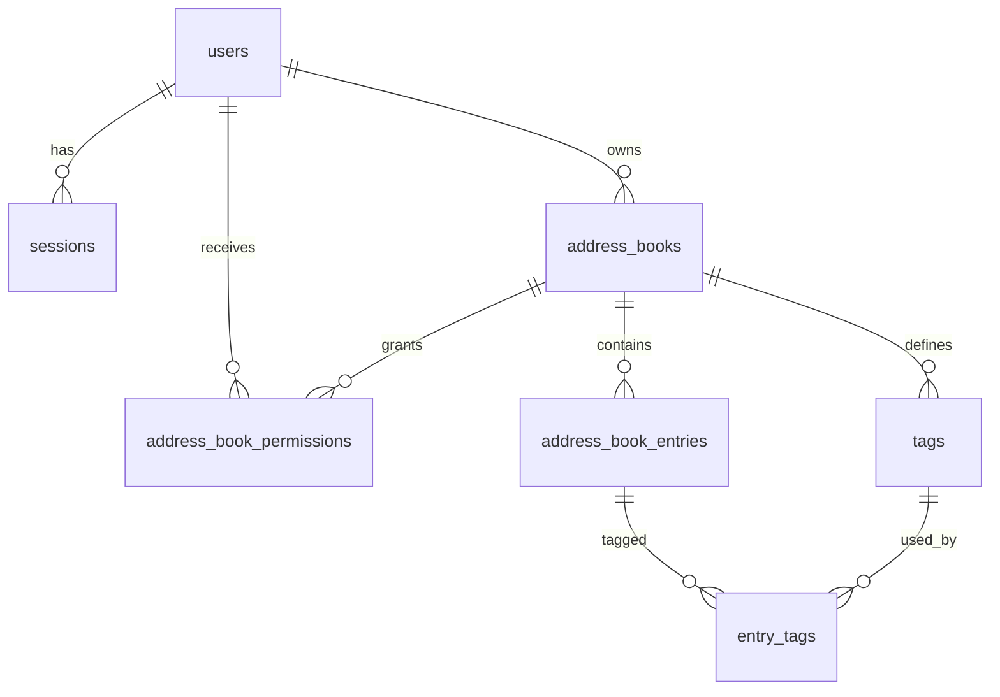

# DATA_MODEL — схема SQLite, миграции и работа с данными

Этот документ — единственный источник правил изменения схемы. Перед правкой
прочитай его целиком и `docs/project/ARCHITECTURE.md` §7.

## 1. Общие принципы

- Одна база. По умолчанию `data/base.db` (`DATABASE_URL` пуст), путь
  анкорится от корня проекта, а не от CWD.
- **Alembic — единственный способ менять схему.** `python -m app` выполняет
  `alembic upgrade head` при каждом старте. Ручной `ALTER TABLE`, правка
  `alembic_version` и «пересоздание базы» запрещены.
- Модели: `app/models/models.py`. Миграции: `alembic/versions/`.
- Первичные ключи — строки UUID (`String(36)`, `str(uuid.uuid4())`),
  генерируются в Python. Это сделано для переносимости SQLite/PostgreSQL.
- Все даты — **naive UTC** (`datetime.utcnow()`), без timezone. Так исторически
  устроена схема; frontend компенсирует это `parseUtc` в `frontend/src/types.ts`.
  Не начинай исправлять это точечно — только полной миграцией всех слоёв.
- SQLite: на каждом соединении включаются `PRAGMA foreign_keys=ON` и
  `PRAGMA busy_timeout=5000` (`app/db/session.py`), `timeout=5` при connect.
  Один writer; долгие bulk-операции блокируют остальные записи.
- PostgreSQL заявлен в `DATABASE_URL`/зависимостях, но миграции и поведение
  проверялись только на SQLite. Считать PostgreSQL **непроверенным**.

## 2. Текущая ревизия

`alembic_version.version_num = '0004'` — фактическое состояние рабочих баз
`data/base.db` и `data/pc-service.db` (обе на `0004`, содержимое разное).

Цепочка миграций:

| Ревизия | Файл | Что делает |
|---|---|---|
| `0001` | `0001_init.py` | создаёт `users`, `sessions`, `address_books`, `customers`, `address_book_entries` (с `customer_id`), `tags`, `entry_tags`, `address_book_permissions` |
| `0002` | `0002_last_seen.py` | добавляет `address_book_entries.last_seen` |
| `0003` | `0003_drop_customers.py` | удаляет `address_book_entries.customer_id` и таблицу `customers` через `batch_alter_table` |
| `0004` | `0004_discovery_and_device_info.py` | аддитивно создаёт `discovered_devices` и `device_info` + индексы |

Все ревизии имеют `upgrade()` и `downgrade()`. `0004.downgrade()` удаляет
только две новые таблицы; данные книг не затрагиваются.

## 3. Таблицы

### 3.1. `users`

| Колонка | Тип | Ограничения | Смысл |
|---|---|---|---|
| `id` | String(36) | PK | UUID пользователя |
| `username` | String(64) | NOT NULL, UNIQUE, index | логин, регистрозависимый |
| `password_hash` | String(255) | NOT NULL | bcrypt |
| `is_admin` | Boolean | NOT NULL, default `0` | доступ к shared-книгам и `/api/v1/users` |
| `is_disabled` | Boolean | NOT NULL, default `0` | блокирует login, Bearer и panel |
| `display_name` | String(128) | NOT NULL, default `""` | отображаемое имя |
| `created_at` | DateTime | NOT NULL | naive UTC |

Связи: `sessions`, `books` (каскадное удаление). При создании пользователя
`create_user()` сразу создаёт личную книгу.

### 3.2. `sessions`

| Колонка | Тип | Ограничения | Смысл |
|---|---|---|---|
| `id` | String(36) | PK | UUID строки |
| `user_id` | String(36) | FK → `users.id` ON DELETE CASCADE, index | владелец |
| `token` | String(255) | NOT NULL, UNIQUE, index | opaque Bearer (`secrets.token_urlsafe(32)`) |
| `created_at` | DateTime | NOT NULL | naive UTC |
| `expires_at` | DateTime | NULL | `NULL` = бессрочно (`SESSION_DAYS=0`) |

Очистка: `purge_expired_sessions()` вызывается при создании сессии,
`user_by_token()` удаляет конкретную просроченную строку при обращении.
`destroy_user_sessions()` удаляет все сессии пользователя при disable или
смене пароля. В таблице хранится **сырой токен** — это осознанный компромисс
ради простоты; БД должна быть защищена как секрет.

### 3.3. `address_books`

| Колонка | Тип | Ограничения | Смысл |
|---|---|---|---|
| `id` | String(36) | PK | `guid` для RustDesk API |
| `name` | String(128) | NOT NULL | имя книги |
| `type` | String(16) | NOT NULL, default `personal` | `personal` \| `shared` |
| `owner_user_id` | String(36) | FK → `users.id` CASCADE, index | владелец |
| `created_at` | DateTime | NOT NULL | naive UTC |
| `updated_at` | DateTime | NOT NULL, onupdate | naive UTC |

Правила: у пользователя одна личная книга (`personal_book`); shared-книги
создаются только админом через `/api/v1/address-books`. Удаление shared-книги
каскадно удаляет entries, tags и permissions (ORM `cascade="all, delete-orphan"`).
Личную книгу удалить нельзя.

### 3.4. `address_book_entries`

| Колонка | Тип | Ограничения | Смысл |
|---|---|---|---|
| `id` | String(36) | PK | UUID записи (используется в `/api/v1/entries/{eid}`) |
| `address_book_id` | String(36) | FK → `address_books.id` CASCADE, index | книга |
| `rustdesk_id` | String(64) | NOT NULL, index | ID устройства; валидируется |
| `alias` | String(128) | NOT NULL, default `""` | отображаемое имя |
| `note` | Text | NOT NULL, default `""` | заметка |
| `username` | String(128) | NOT NULL, default `""` | ОС-пользователь из книги |
| `hostname` | String(128) | NOT NULL, default `""` | хост из книги |
| `platform` | String(32) | NOT NULL, default `""` | платформа из книги |
| `hash_value` | String(255) | NOT NULL, default `""` | hash устройства (personal-книга) |
| `password_encrypted` | Text | NULL | Fernet-шифр пароля (shared-книга) |
| `last_seen` | DateTime | NULL | heartbeat, naive UTC |
| `created_at` | DateTime | NOT NULL | naive UTC |
| `updated_at` | DateTime | NOT NULL, onupdate | naive UTC |

Ограничения: `UNIQUE(address_book_id, rustdesk_id)` (`uq_book_rustdesk`).
Смысл `rustdesk_id` — только безопасный ID: `validate_rustdesk_id` запрещает
`@ / \ ? & =` и пробелы, regex `[A-Za-z0-9][A-Za-z0-9._-]{0,63}`. Это защита
от перенаправления клиента на другой сервер/relay через ID.

Секреты устройства:

- personal-книга: клиент присылает `hash`, он хранится в `hash_value`;
  `password` не возвращается.
- shared-книга: `password` шифруется Fernet в `password_encrypted` и
  расшифровывается при выдаче `/api/ab/peers`.
- `/api/v1` умеет записать `password` в любую книгу (`create_entry`), но
  RustDesk-совместимый ответ всё равно отдаёт `hash` только для personal,
  а `password` — только для shared. Это не ошибка хранения, а разная
  семантика двух API; не «исправляй» без проверки клиента.

`last_seen` обновляется для **всех** записей с данным `rustdesk_id` во всех
книгах: presence глобальна по ID, а не по книге.

### 3.5. `tags`

| Колонка | Тип | Ограничения | Смысл |
|---|---|---|---|
| `id` | String(36) | PK | UUID |
| `address_book_id` | String(36) | FK → `address_books.id` CASCADE, index | книга |
| `name` | String(64) | NOT NULL | имя тега |
| `color` | Integer | NOT NULL, default `0` | ARGB uint из Flutter-клиента |
| `created_at` | DateTime | NOT NULL | naive UTC |
| `updated_at` | DateTime | NOT NULL, onupdate | naive UTC |

`UNIQUE(address_book_id, name)` (`uq_book_tag`). Цвет хранится как целое;
frontend конвертирует его в CSS через `colorCss`/`textOnColor`.

### 3.6. `entry_tags`

| Колонка | Тип | Ограничения |
|---|---|---|
| `entry_id` | String(36) | FK → `address_book_entries.id` CASCADE, часть составного PK |
| `tag_id` | String(36) | FK → `tags.id` CASCADE, часть составного PK |
| `created_at` | DateTime | NOT NULL |

M2M без собственного `id`. Удаление entry или tag каскадно удаляет связи;
удаление тега **не** удаляет устройства, удаление устройства не удаляет теги.
`sync_entry_tags` заменяет набор, `add_entry_tags`/`remove_entry_tags` меняют
частично.

### 3.7. `address_book_permissions`

| Колонка | Тип | Ограничения | Смысл |
|---|---|---|---|
| `id` | String(36) | PK | UUID |
| `address_book_id` | String(36) | FK → `address_books.id` CASCADE, index | книга |
| `user_id` | String(36) | FK → `users.id` CASCADE, index | пользователь |
| `rule` | Integer | NOT NULL, default `1` | 1=read, 2=readWrite, 3=fullControl |

`UNIQUE(address_book_id, user_id)` (`uq_book_user`). `rule` — единственный
источник прав; `can_write(rule) = rule >= 2`; rename/delete shared-книги
требует `rule >= 3`. Admin получает `rule=3` на все shared-книги без строки
permission. Отдельного API управления permissions в панели нет — строки
создаются/меняются на уровне БД или внешним инструментом; не выдумывай
эндпоинт.

### 3.8. `discovered_devices`

| Колонка | Тип | Ограничения | Смысл |
|---|---|---|---|
| `id` | String(36) | PK | UUID |
| `rustdesk_id` | String(64) | NOT NULL, UNIQUE (`uq_discovered_rustdesk`) | ID, увиденный shim |
| `first_seen` | DateTime | NOT NULL | первое событие |
| `last_seen` | DateTime | NOT NULL, index | последнее событие |
| `last_connected` | DateTime | NULL | последний `connect` |
| `last_disconnected` | DateTime | NULL | последний `disconnect` |
| `last_ip` | String(64) | NOT NULL, default `""` | IP клиента на shim |
| `source` | String(16) | NOT NULL, default `""` | `tcp`, `udp`, `tcp,udp` |
| `seen_count` | Integer | NOT NULL, default `0`, cap 2 147 483 647 | число событий |
| `online` | Boolean | NOT NULL, default `0`, index | живое TCP-соединение / свежий UDP |

Семантика: строка = «шим видел этот ID», **не** доказательство личности и
**не** инвентаризация. `online` ставится `connect`/`seen`, снимается
`disconnect` или stale-sweep (`last_seen < now - DISCOVERY_ONLINE_SEC`,
минимум 30 с). Строки живут после отключения. При старте приложения
`reset_online()` снимает `online` у всех. При переполнении очереди события
теряются — это осознанная деградация, а не ошибка БД.

### 3.9. `device_info`

| Колонка | Тип | Ограничения | Смысл |
|---|---|---|---|
| `rustdesk_id` | String(64) | PK | ID устройства (не FK) |
| `hostname` | String(128) | NOT NULL, default `""` | из sysinfo |
| `username` | String(128) | NOT NULL, default `""` | из sysinfo |
| `os` | String(255) | NOT NULL, default `""` | сырая строка ОС |
| `os_name` | String(128) | NOT NULL, default `""` | распарсенное имя |
| `os_version` | String(255) | NOT NULL, default `""` | распарсенная версия |
| `cpu` | String(255) | NOT NULL, default `""` | сырая строка CPU |
| `cpu_model` | String(255) | NOT NULL, default `""` | распарсенная модель |
| `cpu_freq_ghz` | Float | NULL | частота |
| `cpu_logical` | Integer | NULL | логические ядра |
| `cpu_physical` | Integer | NULL | физические ядра |
| `memory` | String(64) | NOT NULL, default `""` | сырая строка RAM |
| `memory_gb` | Float | NULL | распарсенный объём |
| `version` | String(32) | NOT NULL, default `""` | версия клиента |
| `ip` | String(64) | NOT NULL, default `""` | IP из sysinfo/heartbeat |
| `collected_at` | DateTime | NULL | время последнего sysinfo |
| `last_heartbeat_at` | DateTime | NULL | последний heartbeat |

Хранятся только поля белого списка. `uuid`, preset/option-поля и пароли книг
**не** сохраняются. Строка не создаётся heartbeat'ом; её создаёт только
`/api/sysinfo`. `device_info` не связана FK с книгами и может существовать
для ID, которого нет ни в одной книге.

## 4. Связи



`discovered_devices` и `device_info` намеренно **не связаны** FK с
`address_book_entries`: это независимые источники, которые сопоставляются по
`rustdesk_id` только на чтении.

## 5. Три источника присутствия — не смешивать

| Источник | Таблица | Что означает | Кто пишет |
|---|---|---|---|
| Heartbeat | `address_book_entries.last_seen` | устройство с custom `api-server` прислало heartbeat | `POST /api/heartbeat` |
| Discovery | `discovered_devices.online/last_seen` | ID устанавливал TCP/UDP-сессию с shim | shim → очередь → drain |
| Sysinfo | `device_info.collected_at/last_heartbeat_at` | устройство присылало инвентаризацию | `POST /api/sysinfo` |

Они могут расходиться. Не выводи одну из другой и не «синхронизируй» их без
явного решения владельца.

## 6. Изменение схемы: обязательный порядок

1. Прочитай `AGENTS.md` §5 и этот документ.
2. Сделай backup:
   `.venv/bin/python -m app.cli backup` (SQLite Backup API + `integrity_check`,
   файл `data/backup-YYYYmmdd-HHMMSS.db`, mode 600).
3. Создай `alembic/versions/NNNN_<name>.py`:
   - `revision` = следующий номер, `down_revision` = текущий head;
   - `upgrade()` и `downgrade()`;
   - для SQLite-изменений колонок/ограничений — `op.batch_alter_table`;
   - никаких импортов приложения и обращений к реальным данным в миграции.
4. Проверь миграцию **на копии реальной БД**, а не только на пустой:
   скопируй `data/base.db` во временный путь, задай `DATABASE_URL` на копию,
   выполни `alembic upgrade head`, `PRAGMA integrity_check`, затем downgrade
   до предыдущей ревизии и снова upgrade.
5. Проверь, что `git status` содержит файл миграции. Docker/клон видят только
   закоммиченные файлы: незакоммиченная миграция уже приводила к
   `Can't locate revision identified by '0003'` в контейнере. (Сами
   Docker-файлы сейчас не в git — см. `docs/development/WORKFLOW.md` §1.)
6. Обнови этот документ и, если меняется контракт, `API_REFERENCE.md`.
7. Не коммить `data/`, `logs/`, `.env` и backup-файлы.

### Аддитивные vs ломающие изменения

- Новые таблицы/колонки/nullable-поля — безопаснее.
- Удаление/переименование/смена типа — только с планом совместимости:
  сначала добавить новое, заполнить, переключить код, потом удалить старым
  релизом.
- `NOT NULL` без `server_default` на существующей таблице SQLite потребует
  batch-пересборки таблицы; сначала добавь nullable, заполни, потом ужесточай.
- Не меняй `alembic_version` вручную. Если ревизия «потерялась», восстанови
  файл миграции из git, а не подделывай номер.

## 7. Backup и restore

### Backup

```bash
.venv/bin/python -m app.cli backup
# или явный путь:
.venv/bin/python -m app.cli backup --dest /safe/place/base-$(date +%F).db
```

`backup` работает только для SQLite, использует `sqlite3.Connection.backup`
(консистентно при работающем приложении), проверяет `PRAGMA integrity_check`
и ставит файлу `0600`. Для PostgreSQL используй `pg_dump` — CLI этого не
делает.

### Restore

1. Останови приложение (`./scripts/stop.sh` или `docker compose down`).
2. Сохрани текущую БД (не удаляй без копии).
3. Замени файл БД копией, выставь владельца и `0600`.
4. `PRAGMA integrity_check` → `ok`.
5. Запусти приложение: `alembic upgrade head` догонит недостающие ревизии.
6. Проверь `/health/ready`, логин и `/api/ab/personal`.

Нельзя откатывать БД на старую ревизию, если в ней уже есть данные, записанные
новым кодом, без понимания обратной совместимости. Downgrade-миграции — для
разработки и проверки, не для «быстрого отката прода».

## 8. Две исторические базы

`data/base.db` и `data/pc-service.db` — разные файлы с разными данными
(разное число книг/устройств/тегов), обе на `0004`. `.env` указывает на
`base.db`; Docker по умолчанию создаёт `base.db` внутри volume. Если
существующая установка жила на `pc-service.db`, Docker без явного
`DATABASE_URL=sqlite:////app/data/pc-service.db` покажет «пустую» панель.

Правила:

- не переключай `DATABASE_URL` на рабочем инстансе без backup;
- не сливай базы автоматически;
- не удаляй «лишнюю» базу: это данные владельца;
- при сомнении сначала сравни количество строк и книги, не раскрывая
  содержимое в логах/отчётах.

## 9. Retention и рост

- `sessions` чистится от просроченных при login и при обращении с токеном;
  бессрочные (`expires_at IS NULL`) не удаляются никогда.
- `discovered_devices` не чистится автоматически; строки остаются после
  disconnect. Для «мусорных» ID есть admin-only
  `DELETE /api/v1/discovered/{rid}`.
- `device_info` не чистится автоматически; хранит последний отчёт.
- `entry_tags` не имеет индексов сверх PK; при очень больших книгах
  фильтрация по тегам выполняется в Python (`/api/v1`), а не SQL.
- Audit log отсутствует: кто менял запись, кроме `updated_at`, не известно.
