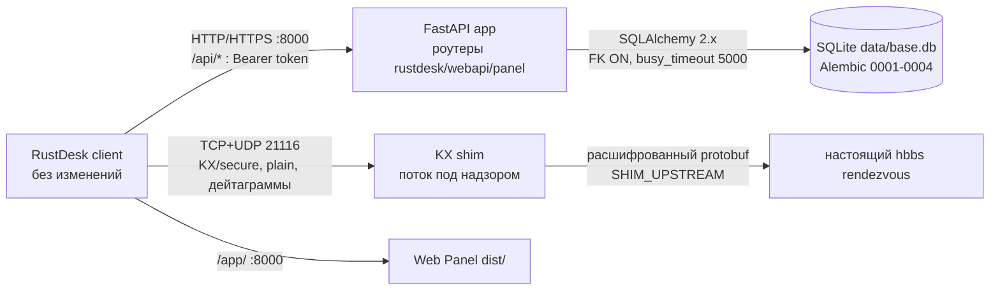

# RustDesk API — Документация (русский)

> [English version](en.md)

Self-hosted Address Book API для обычного клиента RustDesk, плюс Web Panel
и KX shim, позволяющий залогиненным клиентам проходить secure rendezvous
handshake против OSS `hbbs`. **Клиент RustDesk не изменяется.**

Содержание: [1. Обзор](#1-обзор) · [2. Быстрый старт](#2-быстрый-старт) ·
[3. Архитектура](#3-архитектура) · [4. Конфигурация](#4-конфигурация) ·
[5. API reference](#5-api-reference) · [6. Shim](#6-shim) ·
[7. Безопасность](#7-безопасность) · [8. Разработка и тесты](#8-разработка-и-тесты) ·
[9. Troubleshooting](#9-troubleshooting) ·
[10. Фон: расследование secure-tcp](#10-фон-расследование-secure-tcp)

---

## 1. Обзор

Клиенты RustDesk умеют хранить адресную книгу (устройства, алиасы, теги,
заметки, пароли устройств) на сервере через `/api/ab/*`. Этот проект —
совместимая реализация такого server API, расширенная панелью управления
и rendezvous-шимом.

Компоненты и ответственность:

- **API (FastAPI)** — login/токены, личные + общие книги
  (`read`/`readWrite`/`fullControl`), CRUD peers, CRUD тегов с цветами и
  переименованием, админка пользователей, поиск, AND/OR-фильтры,
  пагинация, presence (`online`/`offline`/`unknown` + `last_seen` из heartbeat).
- **Web Panel** — React 19 + Vite + TS + Tailwind 4 SPA на `/app/` (legacy
  server-rendered UI остался на `/panel/`).
- **KX shim** — rendezvous-прокси на TCP+UDP `21116`. Залогиненные клиенты RustDesk
  1.4.x требуют server-first `KeyExchange`-хендшейк, который OSS `hbbs` никогда
  не шлёт (иначе `Failed to secure tcp: deadline has elapsed`). Шим выполняет
  серверную сторону хендшейка ключом вашего hbbs и проксирует расшифрованный
  трафик в настоящий `hbbs`. Клиенты без логина (plain) идут транзитом.
- **Хранилище** — одна SQLite-база `data/base.db`, миграции Alembic.

Возможности и ограничения версии: Docker-файлы есть в рабочем каталоге
(`Dockerfile`, `docker-compose.yml`, `.dockerignore`), но сейчас перечислены в
`.gitignore`, поэтому чистый клон не сможет собрать образ, пока их не добавят
в git; без встроенной TLS-терминации
(спереди Caddy/Nginx); в legacy
панели нет per-form CSRF-токенов (только SameSite=Lax); presence через
heartbeat подделываем в пределах лимита (credentials у устройств нет по
дизайну клиента).

## 2. Быстрый старт

Debian/Ubuntu, Python 3.13, root не нужен (все дефолтные порты > 1024).
Docker опционален (файлы есть в рабочем каталоге, см. `README.md`), но сейчас
они не отслеживаются git. Для опциональной пересборки React: Node.js 22 LTS.

Из корня репозитория — команды по одной, чтобы ошибку было легко найти:

```bash
git clone <your-repo-url> rustdesk-manager
cd rustdesk-manager
python3 -m venv --without-pip .venv
```

(Debian Python без `ensurepip`; флаг — ожидаемо, не ошибка.)

```bash
.venv/bin/python /tmp/get-pip.py
```

(`get-pip.py` с https://bootstrap.pypa.io/get-pip.py.)

```bash
.venv/bin/pip install -r requirements.txt
cp .env.example .env
```

Два обязательных секрета в `.env` (проверенные установленные версии: FastAPI
0.143.0, Uvicorn 0.54.0, SQLAlchemy 2.1.4, Pydantic 2.14.1, bcrypt 5.0.0;
остальное — диапазоны в `requirements.txt`):

```bash
.venv/bin/python -m app.cli gen-key   # вывод в DEVICE_SECRET=
# вывод `openssl rand -hex 32` в WEB_SECRET=
```

Без секретов старт отказывается (`FATAL: … is not set`), кроме `DEV_MODE=1`
(только локальные эксперименты). Далее:

```bash
./scripts/start.sh
```

По порядку: проверка конфигурации → создание `data/`+`logs/` (`0700`,
существующей `data/base.db` — `0600`) → `alembic upgrade head` → Uvicorn на
`HOST:PORT` (по умолчанию `127.0.0.1:8000`) → супервизор шима, если
`SHIM_ENABLED=1`. `python -m app` делает то же и работает из любого каталога
(пути привязаны к корню проекта, не к CWD).

Проверка:

```bash
curl http://127.0.0.1:8000/health/ready
```

→ `{"status":"ready","db":"up","shim":{"state":"disabled"}}`
(`disabled` без шима — норма; с шимом `running/alive:true`;
`down` после серии падений — см. §9). Панель: `http://127.0.0.1:8000/app/`.
Интерактивные доки API **выключены по умолчанию**; они доступны только при
`DEV_MODE=1` или `EXPOSE_DOCS=1` (`http://127.0.0.1:8000/docs`).

Первый админ (второй терминал, сервер работает) и первый запрос:

```bash
.venv/bin/python -m app.cli create-admin     # спросит логин и пароль
curl -X POST http://127.0.0.1:8000/api/login \
  -H 'Content-Type: application/json' \
  -d '{"username":"USER","password":"PASS","type":"account"}'
```

→ `200 {"access_token":"…","type":"access_token","user":{…}}`.
В клиенте RustDesk указать API Server `http://<host>:8000` и войти:

```bash
curl -X POST http://127.0.0.1:8000/api/ab/personal \
  -H 'Authorization: Bearer TOKEN' -H 'Content-Length: 0'
```

→ `200 {"guid":"…"}`.

Остановка: `Ctrl+C` (SIGTERM аналогично — API завершает запросы, поток шима
стопится с join 10 с, сирот нет) или `./scripts/stop.sh` (проверяет PID-файл
по живому `python -m app`, затем ищет процесс по cwd/cmdline). Перезапуск —
та же команда; миграции идемпотентны.

## 3. Архитектура

Один процесс отдаёт HTTP и супервизирует шим в фоновом потоке. Одна база.
Без микросервисов.



Путь запроса: `POST /api/login` → opaque серверный токен (`sessions`, срок
`SESSION_DAYS`; logout удаляет) → `POST /api/ab/*` с `Authorization: Bearer`
(доступ к книге перепроверяется при каждом запросе: `get_book_for_user` +
`rule_for`) → устройства шлют `POST /api/heartbeat {id,…}`, штампуется
`last_seen` (вывод: `online` ≤ 45 с, иначе `offline`, не виденные — `unknown`)
→ SPA панели ходит в `/api/v1/*` с тем же токеном из `localStorage`
(`ab_token`).

Границы доверия: сеть недоверенная (все `/api/*`, кроме login/login-options/
heartbeat/health, требуют валидный токен; в протоколе шима аутентификации нет
— сдерживается лимитами). Bearer-токены — в `localStorage` браузера
(`ab_token`) и таблице `sessions`. `data/` — `0700`, БД/бэкапы — `0600`;
приватник hbbs — только
чтение, никогда в git/логи/ответы. Заголовки `X-Forwarded-*` по умолчанию
игнорируются; только если прямой пир — настроенный доверенный прокси
(`TRUSTED_PROXIES`), `X-Forwarded-For` используется, и лишь для ключа
per-IP лимитов. hbbs доверен в части punch/relay-медиации; credentials API он
не видит.

Состав репо: `app/` (FastAPI: `main.py`, `__main__.py`, `api/`, `core/`,
`models/`, `schemas/`, `services/`, `db/`, `cli.py`, `shim/`,
`shim_supervisor.py`, `web/templates/`), `frontend/` (`src/`, собранный
`dist/`), `alembic/`, `scripts/` (`start.sh`/`stop.sh` плюс
`repro_handshake.py`, `check_keys.py`), `config/`
(примеры Caddy/systemd), `data/` + `logs/` (рантайм).

## 4. Конфигурация

Источник истины: `app/core/config.py` + `.env.example`. Всё — переменные
окружения; `.env` в корне подхватывается сам. Настоящие значения в git не коммитить.

| Переменная | Обязательна | Формат / дефолт | Кем используется |
|---|---|---|---|
| `DEVICE_SECRET` | да (или `DEV_MODE=1`) | Fernet-ключ из `app.cli gen-key` | Шифрует сохранённые пароли устройств; ротация их теряет |
| `WEB_SECRET` | да (или `DEV_MODE=1`) | случайные 32+ символов | Подписывает cookie-сессии legacy-панели; ротация только разлогинивает |
| `DEV_MODE` | `0` | `0`/`1` | Терпит отсутствие секретов — только dev |
| `HOST` / `PORT` | `127.0.0.1` / `8000` | IP / порт | Listen FastAPI; `0.0.0.0` для LAN (за TLS, см. §7) |
| `DATABASE_URL` | `data/base.db` | SQLAlchemy URL | Где база (абсолютный; относительные sqlite-пути привязываются к `data/`; Postgres URL принимается) |
| `SESSION_DAYS` | `30` | int, `0` = бессрочно | Время жизни токена (на враждебных сетях уменьшайте) |
| `MAX_PEER_ONE_AB` | `0` = безлимит | int | Лимит устройств на книгу; превышение → `403 exceed_max_devices` |
| `LOG_LEVEL` | `INFO` | уровень | Уровень логов Uvicorn |
| `SHIM_ENABLED` | `0` | `0`/`1` | Запускает шим под супервизором |
| `SHIM_LISTEN` | `127.0.0.1:21116` | `host:port` | Адрес **бинда** — обязан быть локальным (`0.0.0.0` для LAN); на чужой IP bind невозможен |
| `SHIM_UPSTREAM` | `127.0.0.1:21166` | `host:port` | Настоящий hbbs rendezvous. Та же машина: `hbbs -p 21166`. Другая: `HBBS_IP:21116`. **Никогда relay `21117`** |
| `SHIM_ID_KEY` | да, если шим вкл. | абс. путь к **приватному** `id_ed25519` hbbs (64-байтный секрет) | Подписывает серверный KeyExchange; 44-байтный `.pub` подписать не может и отвергается |
| `SHIM_MAX_CONNS` / `SHIM_PER_IP_PER_MIN` | `200` / `30` | int | DoS-лимиты rendezvous-порта |
| `MAX_BODY_BYTES` | `5242880` | int | Тела больше → `413` |
| `LOGIN_PER_MINUTE_PER_IP` | `20` | int | Больше логинов → `429` |
| `HEARTBEAT_PER_MINUTE_PER_DEVICE` | `20` | int | Больше heartbeat от одного устройства (ключ: `id` + IP) → `429` |
| `HEARTBEAT_PER_MINUTE_PER_IP` | `6000` | int | Агрегатный потолок heartbeat на IP → `429` |
| `SYSINFO_PER_MINUTE_PER_IP` | `6000` | int | Агрегатный лимит sysinfo на IP; дубликаты подтверждаются без записи в БД |
| `DISCOVERY_ENABLED` | `1` | `0`/`1` | Переносить события discovery из шима в SQLite |
| `DISCOVERY_ONLINE_SEC` | `180` | int | Помечать молчащее обнаруженное устройство offline |
| `TRUSTED_PROXIES` | пусто | список IP через запятую | Доверять `X-Forwarded-For` от этих пиров для ключа лимитов; пусто = не доверять вовсе |
| `EXPOSE_DOCS` | `0` | `0`/`1` | Отдавать `/docs`, `/redoc`, `/openapi.json` (авто-вкл в `DEV_MODE`; в проде выкл) |

Связка API↔shim — это ровно: `SHIM_LISTEN` (куда идут клиенты),
`SHIM_UPSTREAM` (где слушает настоящий hbbs), `SHIM_ID_KEY` (чем шим
подписывает). Пример (LAN-стенд, placeholders):

```bash
DEVICE_SECRET='<вывод gen-key>'
WEB_SECRET='<openssl rand -hex 32>'
HOST=0.0.0.0
SHIM_ENABLED=1
SHIM_LISTEN=0.0.0.0:21116
SHIM_UPSTREAM=192.0.2.10:21116
SHIM_ID_KEY=/opt/keys/hbbs-id_ed25519
```

## 5. API reference

Сверено с `app/api/*.py`; живая схема на `/docs`. Доступ: opaque Bearer
(кроме login, login-options, heartbeat, sysinfo, sysinfo_ver, health). Ошибки: `401 {"error"}` и
RustDesk `{"error"}` с 400/403/404/409.

**Контракт RustDesk** (им пользуется неизменённый клиент — форматы заморожены):

| Метод | Путь | Тело → Ответ |
|---|---|---|
| POST | `/api/login` | `{username,password,type:"account",…}` → `200 {access_token,type:"access_token",user:{name,display_name,avatar,email,note,status,is_admin}}` |
| POST | `/api/currentUser` | `{id,uuid}` → объект пользователя |
| POST | `/api/logout` | `{id,uuid}` → `200` пусто (токен отозван) |
| GET | `/api/login-options` | → `[]` |
| POST | `/api/ab/settings` | пусто → `{max_peer_one_ab}` |
| POST | `/api/ab/personal` | пусто → `{guid}` (книга создаётся сама) |
| POST | `/api/ab/shared/profiles?current=&pageSize=` | пусто → `{total,data:[{guid,name,owner,note,info,rule}]}` (`1`=read `2`=readWrite `3`=fullControl) |
| POST | `/api/ab/peers?current=&pageSize=&ab={guid}` | пусто → `{total,data:[Peer]}` (`id,username,hostname,platform,alias,tags[],note` + `hash` личная / `password` общая) |
| POST | `/api/ab/peer/add/{guid}` | один peer JSON → `200` пусто; `409` дубликат, `422` плохой ID, `403` read-only/лимит |
| PUT | `/api/ab/peer/update/{guid}` | `{id,…поля}` (tags = полный новый набор) → `200` пусто |
| DELETE | `/api/ab/peer/{guid}` | `["id",…]` → `200` пусто |
| POST | `/api/ab/tags/{guid}` | пусто → `[{name,color}]` (голый массив) |
| POST | `/api/ab/tag/add/{guid}` | `{name,color}` → `200` пусто |
| PUT | `/api/ab/tag/rename/{guid}` | `{old,new}` → `200` пусто |
| PUT | `/api/ab/tag/update/{guid}` | `{name,color}` (color = Flutter ARGB uint) → `200` пусто |
| DELETE | `/api/ab/tag/{guid}` | `["name",…]` → `200` пусто (устройства остаются) |
| POST | `/api/heartbeat` | `{id,uuid,ver,…}`, **без авторизации** → `{}`; штампует `last_seen` |
| GET/POST | `/api/ab` | legacy-заглушки полной книги (`"null"` / пустой 200) |
| GET | `/api/device-group/accessible`, `/api/users`, `/api/peers` | заглушки group-панели → `{total:0,data:[]}` |

`rustdesk_id` вне `[A-Za-z0-9._-]` (особенно `@ / \ ? & =`, пробелы)
отклоняются с `422` — такие ID перенаправляли бы транспорт клиента.

**Panel JSON** (префикс `/api/v1`, тот же Bearer):

| Метод | Путь | Примечания |
|---|---|---|
| GET | `/stats` | `{devices,online,offline,unknown,discovered,discovered_online}`; счётчики книг — по видимым, discovered — server-wide |
| GET/POST | `/address-books` | список со счётчиками и твоим `rule`; создание `{name}` (admin, shared) |
| PUT/DELETE | `/address-books/{bid}` | rename / delete shared-книги, только fullControl (rule 3); личные нельзя ни переименовать, ни удалить |
| GET | `/address-books/{bid}/entries` | `search,tag[] (повтор),mode=and\|or,untagged,presence=all\|online\|offline\|unknown,sort=alias\|rustdesk_id\|last_seen\|status,order,page,page_size(≤200)` → `{total,data}` с `tag_objs[{name,color}]`, `presence`, `last_seen`, `password_configured`, timestamps |
| POST | `/address-books/{bid}/entries` | `{rustdesk_id,alias,note,tags[],password}`; `409` дубликат |
| GET/PUT/DELETE | `/entries/{eid}` | полный объект; PUT с пустым `password` оставляет старый |
| GET/POST | `/address-books/{bid}/tags` | `[{id,name,color,devices}]`; `409` на дубликате |
| PUT/DELETE | `/tags/{tid}` | rename+color; удаление рвёт только связи |
| PUT/DELETE | `/entries/{eid}/tags/{tid}` | attach/detach |
| GET/POST | `/users`, PUT/DELETE | `/users/{uid}`; только admin; PUT `{username?,is_admin?,is_disabled?,password?}`; self-delete/disable/demote запрещены |

**Legacy-страницы** (`/panel/*`, cookie-сессия, HTML): `GET/POST /login`,
`GET /logout`, `/devices`, `/tags`, `/users` с соответствующими
create/update/delete form-posts; без входа → `303 /panel/login`.

**Health:** `GET /health` → `{"ok":true}`; `/health/live` → live;
`/health/ready` → `200 ready/db/shim…` или `503` с упавшим компонентом
(все исключены из OpenAPI-схемы).

## 6. Shim

Установка: увести rendezvous вашего `hbbs` с клиентского порта
(`hbbs -p 21166`; `21117` — relay, как upstream запрещён), задать три
`SHIM_*` (§4), перезапустить, `GET /health/ready` →
`"shim":{"state":"running","alive":true}`, в клиенте ID server — на хост шима
с тем же Key, что для hbbs. Входите и подключаетесь из книги: в логе шима
`secure established`; подключения без логина — `plain passthrough`.

Внутренности (TCP): на accept шим сразу шлёт `KeyExchange{sign(box_pk)}`; ответный
`KeyExchange` с 2 ключами включает secretbox (схема v0 `set_key`: счётчики на
направление инкрементятся до использования, первый шифрокадр — nonce 1,
пустые кадры идут открыто); любой другой первый кадр — plain passthrough
(plain-клиенты наш KX игнорируют через свой `get_next_nonkeyexchange_msg`).

Внутренности (UDP): тот же listen-порт ретранслирует rendezvous UDP-дейтаграммы
(регистрация, NAT-тест, координация punch) в upstream hbbs. На UDP-пути нет
криптографии по дизайну протокола, поэтому это обычный форвардер: каждому
адресу клиента — свой исходящий сокет (ответы возвращаются однозначно),
простаивающие сессии умирают через 120 с, новые сессии делят лимиты
`SHIM_MAX_CONNS` / `SHIM_PER_IP_PER_MIN` (лимитируется только создание сессий,
keepalive — нет). Проверено: ответы побайтово идентичны прямым от hbbs.
Сбои: недоступный upstream закрывает соединение через 10 с с warning;
crash loop → `down` + `503` на ready после 5 падений за 10 мин (бэкофф
1,2,4,8,16,30,60 с), API продолжает работать; `/health/ready` — единственный
источник статуса. Автономный диагностический режим — в `scripts/`
(`repro_handshake.py`, `check_keys.py` — только хэши).

Что канал даёт, а что нет (доказано, не предполагается): плечо клиент↔шим
шифруется secretbox на ключе соединения, запечатанном под шим; открытым
текстом трафик существует только на плече шим↔hbbs, которое обязано быть на
доверенном loopback/LAN. Не даётся: аутентификация клиентов на
rendezvous-порту (её нет в самом протоколе) — сдерживается лимитами (200
коннектов, 30/мин/IP, кадры 2 МБ, чтения 60 с). Сквозное шифрование сеанса
остаётся между двумя эндпоинтами RustDesk, шим его не видит.

## 7. Безопасность

Обеспечивается кодом: только bcrypt-пароли; серверные сессии с отзывом при
logout и автоматическим отзывом всех токенов юзера при disable/смене пароля;
проверка владения/ролей книг при каждом запросе; недоверие присланным
ролям/владельцам; ORM + bound-параметры + whitelist sort; `data/` `0700`,
БД/бэкапы `0600` на старте; Fernet-пароли устройств, секретов в логах нет
(шим — только отпечатки); нет CORS-middleware (same-origin SPA);
`X-Forwarded-*` читаются только от настроенных доверенных прокси и только для
ключа лимитов; `/docs`+`/openapi.json` в проде выключены; протухшие сессии
чистятся; в React нет `dangerouslySetInnerHTML`, в Jinja автоэскейп включён;
legacy-панель перепроверяет `is_disabled` на каждом запросе; в ошибках нет
трейсов/путей/SQL. Зависимости на момент проверки: `pip-audit` чисто,
`bandit` 0 High, `npm audit` 0 уязвимостей.

Известные принятые ограничения: неаутентифицированный heartbeat может шуметь
в presence в пределах лимита; в legacy-панели нет
per-form CSRF (только SameSite=Lax); дефолтный `SESSION_DAYS=30` долог для
враждебных сетей; само приложение отдаёт plain HTTP — для всего шире loopback
спереди TLS-терминация (Caddy/Nginx).

## 8. Разработка и тесты

Окружение = установка из §2 + для UI `cd frontend && npm install` (Node.js 22);
dev-сервер фронта (`npm run dev`) проксирует `/api` на `127.0.0.1:8000`,
`npm run build` пишет `frontend/dist/` на `/app/`. Проверка вручную:
`/health/ready`, login + `/api/ab/personal` из §2, скрипты с живым сервером
в `scripts/` (нужен запущенный `hbbs`). Коммитов в remote нет.

Состав: `app/` (FastAPI: `main.py`, `__main__.py`, `api/`, `core/`, `models/`,
`schemas/`, `services/`, `db/`, `cli.py`, `shim/`, `shim_supervisor.py`,
`web/templates/`), `frontend/` (`src/`, собранный `dist/`), `alembic/`
(0001–0004), `scripts/` (`start.sh`/`stop.sh` + …),
`config/` (примеры Caddy/systemd), `data/` + `logs/` (рантайм).

## 9. Troubleshooting

Порядок: stdout/stderr (`journalctl` или `docker compose logs`) →
`/health/ready` → порты → конфиг. Файл `logs/app.log` приложение не создаёт.
`FATAL: …SECRET…` — заполнить `.env` (или `DEV_MODE=1` для экспериментов).
`No module named app` — запуск из корня / через `start.sh`. Порт занят —
`ss -tlnp`, остановить держателя (`stop.sh` проверяет PID + cwd/cmdline и
ищет `python -m app`).
Crash-loop шима на bind — освободить `SHIM_LISTEN` или увести `hbbs`.
**`SHIM_LISTEN` на чужом IP биндиться не может** (`Cannot assign requested
address` — наблюдено живьём); **`SHIM_ID_KEY` обязан быть 64-байтным приватным
`id_ed25519`, а не 44-байтным `.pub`** (тоже наблюдено живьём — подписать
пабликом нельзя). `LICENSE_MISMATCH` — Key клиента ≠ паблик hbbs (проверка
hbbs, к шиму не относится). Login `429` — троттлинг, подождать минуту. `413`
— поднять `MAX_BODY_BYTES` только для легитимно больших push. `401 {"error"}`
— войти заново. `403 exceed_max_devices` — квота. `422` на peer add —
запрещённые символы ID. Пустой `200` на action `/api/ab/*` — успех. Проблемы
TLS чинятся на прокси/доверии CA, verification не отключать.

## 10. Фон: расследование secure-tcp

Залогиненные клиенты 1.4.x требуют server-first `KeyExchange` rendezvous
хендшейк; OSS `hbbs` первым не говорит никогда (доказано живьём: TCP за ~2 мс,
далее 12–35 с тишины, в исходниках нет обработчика `KeyExchange`) →
`Failed to secure tcp: deadline has elapsed` до любого peer-контакта при любых
ключах. Logout убирает токен → plain punch (~1 мс, воспроизведён побайтово) →
работает. Данные peers на падающую стадию влиять не могут (общий путь
`connect()`; пароли — post-handshake); единственный AB-специфичный вектор
транспорта (`@`/`/r` в ID) отклоняется сервером с 422. Шим выше — фикс,
сохраняющий стоковые клиенты и OSS hbbs вместе. Схема API (HTTP vs HTTPS) на
эту стадию не влияет — HTTPS защищает credentials клиент↔API, ранее шедшие
открытым текстом.
